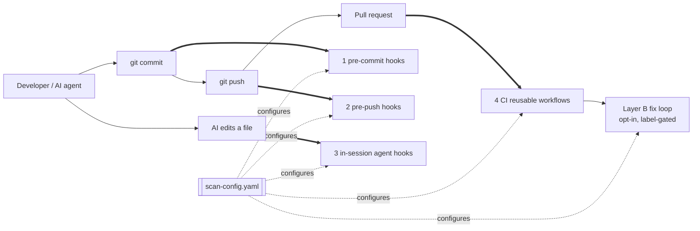

# auto-code-scanning

[](https://github.com/agenticcodingops/auto-code-scanning/actions/workflows/ci.yml)
[](https://github.com/agenticcodingops/auto-code-scanning/releases/latest)
[](LICENSE)

auto-code-scanning adds security and quality scanning to your repositories from one
place. It checks Terraform and other infrastructure as code (IaC), C#/.NET,
TypeScript/JavaScript and SQL with open-source scanners such as Trivy, Checkov, TFLint,
Gitleaks and Semgrep. The same checks run on a developer's machine before code leaves
it, and again in GitHub Actions on every pull request. One file, `scan-config.yaml`,
says which languages and tools are on. The aim is to catch problems early, including
in code written by AI coding agents, without each repository building its own setup.

> Pin to a released tag (currently `v3.1.3`) or a commit SHA, **never `@main`**. <!-- x-release-please-version -->

## What it enforces

The platform has two layers:

- **Layer A: scanning** (always on). Local Git hooks and reusable CI workflows run the
  scanners, and each one blocks at its own documented threshold.
- **Layer B: the AI fix loop** (opt-in, off by default). On a pull request you label,
  an AI agent proposes a minimal fix. Separate jobs build it without secrets and check
  it before anything is pushed.

Checks run at four enforcement points:

| # | Enforcement point | When it runs | What it does |
| --- | --- | --- | --- |
| 1 | **pre-commit hooks** | every `git commit` | Scans the staged changes. Findings and incomplete scans block the commit by default. |
| 2 | **pre-push hooks** | every `git push` | Runs deeper checks (for example Checkov, TFLint, a .NET build) on the exact commits being pushed. |
| 3 | **in-session agent hooks** | each file an AI agent edits | Claude Code hooks from `templates/claude/` scan the edit so the agent can fix it before it says it is done. |
| 4 | **CI reusable workflows** | every pull request and push | The authoritative check: uploads SARIF reports to code scanning, comments on the PR and fails the check on blocking findings. |

Local hooks give fast feedback; CI is the backstop. A clean local run does not replace
the hosted checks.



## Get started

1. **[Quick start (5 minutes)](docs/QUICK-START-5MIN.md):** the shortest path to a
   first scanned commit.
2. **[Prerequisites](docs/PREREQUISITES.md):** the tools to install on Windows, macOS
   or Linux.
3. **[Getting started](docs/SETUP-GUIDE.md):** the full setup guide: choosing a tier,
   Terraform and application repositories, CI permissions, hooks, first scans,
   exceptions and upgrades.
4. **[Examples](examples/):** small working repositories to copy from.

### Choose a tier

| Tier | pre-commit hook set | Fix loop |
| --- | --- | --- |
| **starter** | Trivy secrets, file hygiene, `terraform fmt` | off |
| **standard** (recommended) | adds Gitleaks, CRITICAL IaC, TFLint, `terraform validate` | wired, off |
| **strict** | adds full IaC, strict Checkov, suppression validation | on (still needs the PR label) |

Lefthook, the default runner, installs the same hooks, application-code hooks
included, for every tier. A tier does not change CI thresholds. See
[tier selection](docs/SETUP-GUIDE.md#2-choose-a-tier-and-runner) and the
[tier upgrade guide](docs/TIER-UPGRADE-GUIDE.md).

### Pin a version

Pinning is a two-step story:

1. The shipped templates pin the current release **tag**:
   for example `uses: …/reusable-scan.yml@v3.1.3` in a caller workflow and <!-- x-release-please-version -->
   `rev: v3.1.3` in a pre-commit configuration. <!-- x-release-please-version -->
2. After setup, replace each tag with the full 40-character **commit SHA** that tag
   points to, and pass the same SHA as `scanning-repo-ref` (or `scanning_repo_ref` for
   the fix loop). A SHA cannot be moved; a tag could be.

[VERSION-PINNING](docs/VERSION-PINNING.md) shows how to find the SHA and how to upgrade.
Only exact version tags such as `v3.1.3` are published. There is no floating major tag <!-- x-release-please-version -->
such as `v3`, so `@v3` does not resolve.

## How it works

### Local hooks

[Lefthook](https://github.com/evilmartians/lefthook) is the default local hook runner;
[pre-commit](https://pre-commit.com/) is a supported alternative. Both call the same
`hooks/dispatcher.sh`. It checks the `local_hooks_enabled` switch in `scan-config.yaml`,
detects the operating system and runs the right implementation (`.ps1` on Windows,
`.sh` on Linux and macOS). Commit hooks scan the staged content; push hooks scan the
exact commits being pushed. Setup errors and incomplete scans block rather than pass.
See the [hook reference](docs/HOOK-REFERENCE.md) and its
[exit-code contract](docs/HOOK-REFERENCE.md#exit-code-contract).

### CI workflows

Your repository calls the reusable workflows from small caller workflows:

- `reusable-scan.yml` scans Terraform with Trivy, Checkov, TFLint and optionally Snyk,
  then combines the results, applies your exceptions and baseline, and fails on
  blocking findings.
- `code-security-scan.yml` scans application code with Semgrep per language, plus a
  secret scan.

Each tool uploads its own SARIF report (Static Analysis Results Interchange Format) to
GitHub code scanning under a separate category. Inputs, outputs and permissions for
every workflow are in [REUSABLE-WORKFLOWS](docs/REUSABLE-WORKFLOWS.md).

### The AI fix loop (opt-in)

When `fix_loop.enabled: true` is set on the base branch and a trusted maintainer adds
the `ai-autofix` label to a pull request, `autonomous-fix.yml` runs:

- The **analysis** job has a read-only token and no push credentials. The agent writes
  a patch, which is scanned for secrets.
- A separate **verification** job builds the patch without secrets.
- The **publication** job runs no project code. It checks that the patch only touches
  allowed paths, scans the changed files, and pushes. Otherwise it labels the PR
  `needs-human-review`.

The settings are read from the base branch, so a pull request cannot turn the loop on
or widen it through its own changes. Read [FIX-LOOP](docs/FIX-LOOP.md) and the
[security model](docs/SECURITY-MODEL.md) before you enable it.

### Your repository and the platform

Your repository **references** the reusable workflows by a pinned SHA and **vendors**
(copies byte for byte) `hooks/`, `schemas/` and the shared `scripts/` from the same
release. To upgrade, move every pin together and copy the files again. Scanner rules
and first-run caches can still need network access. When you upgrade across releases,
read [consumer migration](docs/CONSUMER-MIGRATION.md) and the [changelog](CHANGELOG.md).

## Documentation

The [documentation index](docs/README.md) lists every guide in reading order, from
the overview to day-to-day operation and reference. What changed in each release is in
the [changelog](CHANGELOG.md).

## Repository structure

```text
auto-code-scanning/
├── scan-config.yaml                # languages, tools and fix_loop settings
├── schemas/                        # JSON schemas for scan-config and exception files
├── .pre-commit-hooks.yaml          # pre-commit manifest (alternative runner)
├── hooks/                          # dispatcher.sh + per-tool .sh/.ps1 + lib/
├── .github/workflows/              # reusable-scan, code-security-scan, autonomous-fix and this repo's CI
├── templates/                      # tier configs, Lefthook, pre-commit, Claude Code bundle, caller workflows
├── scripts/                        # setup, scanning, baseline and validation scripts
├── configs/                        # per-cloud IaC tool configs (aws/azure/gcp/common)
├── tests/                          # fixtures, Python, Pester and integration tests
├── docs/                           # documentation (start with docs/README.md)
└── archive/                        # historical material, not maintained
```

## Contributing, security and license

- **Contributing:** read [CONTRIBUTING](CONTRIBUTING.md) and the
  [Code of Conduct](CODE_OF_CONDUCT.md).
- **Security:** report vulnerabilities privately as described in [SECURITY](SECURITY.md).
  Do not open a public issue.
- **License:** [Apache License 2.0](LICENSE).
