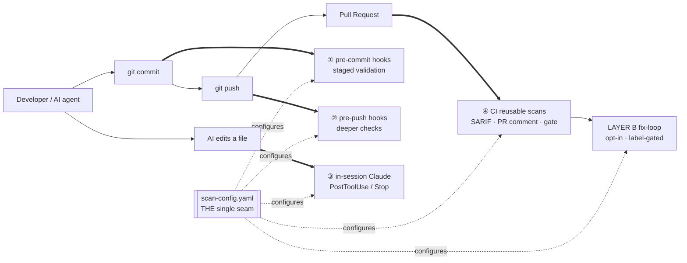
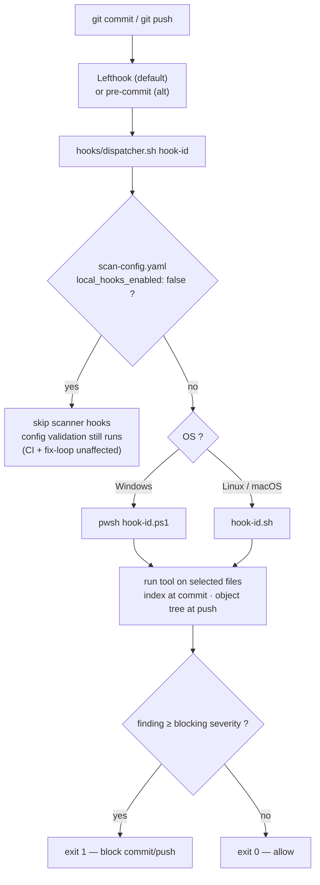
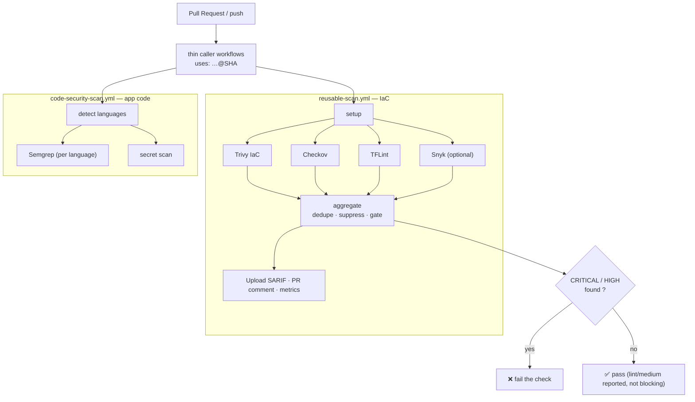
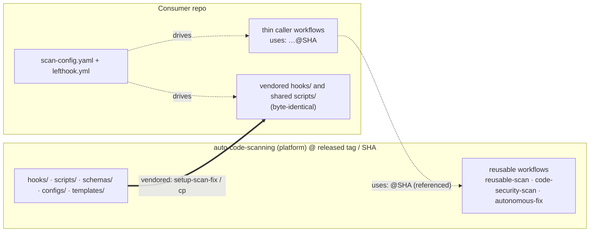

# auto-code-scanning

**[Getting started](docs/SETUP-GUIDE.md)** is the single adoption path.
For repository changes, read [Contributing](docs/CONTRIBUTING.md).

**A reusable, configurable scan→fix platform** for many repositories. One config file
(`scan-config.yaml`), four enforcement points, two layers — engineered to be friction-free
for **autonomous Claude Code** loops and safe for public adoption.

- **LAYER A — Scanning** (always on): Terraform/IaC **and** application code (C#/.NET,
  TypeScript/JS, SQL) via shared OS-detecting local hooks **and** reusable CI workflows.
- **LAYER B — Agentic fix-loop** (opt-in): a hardened workflow with separate analysis, verification and publication jobs where an AI agent
  proposes a *minimal* fix and separate jobs build it without secrets and verify the exact tree before pushing it — gated by a path
  allowlist, a PR label, and SHA-pinned actions.

> Apache-2.0. Terraform scanning is fully preserved. Pin consumers to a **released tag**
> (currently `v3.0.6`) or a commit **SHA** — **never `@main`**. <!-- x-release-please-version -->

---

## The big picture

`scan-config.yaml` supplies language and policy settings. Runner manifests select local
hooks, and reusable workflows select hosted checks. Their scopes differ; CI is the
authoritative backstop. A clean local hook run does not replace every hosted check.



| # | Enforcement point | When | Tool runner | Posture |
|---|---|---|---|---|
| ① | **pre-commit hooks** | every `git commit` | Lefthook → `hooks/dispatcher.sh` | staged validation; incomplete scans block by default |
| ② | **pre-push hooks** | every `git push` | Lefthook → `hooks/dispatcher.sh` | deeper (build, tflint, checkov) |
| ③ | **in-session Claude hooks** | each file an AI agent edits | `templates/claude/` PostToolUse/Stop | self-correct before "done" |
| ④ | **CI reusable workflows** | every PR / push | `workflow_call` (pinned `@SHA`) | authoritative, SARIF + gate |

---

## Getting started

Follow **[Getting started](docs/SETUP-GUIDE.md)** for prerequisites, choosing a tier,
Terraform and application repositories, public/private CI permissions, full release
commit pins, hooks, first scans, suppressions, baselines and upgrades. It includes
Windows, macOS and Linux commands and starts with scanning before the optional fix loop.

See the [v3.0.0–v3.0.6 behaviour audit](docs/V3-BEHAVIOUR-AUDIT.md) for shipped changes
and the documentation that covers each one.

---

## LAYER A — Scanning

**The config seam.** `scan-config.yaml` declares which languages and tools are enabled.
Local runner manifests also need review: a language flag does not remove their commands.

```yaml
global:
  local_hooks_enabled: true          # false pauses scanners; config validation still runs
  blocking_severities: [CRITICAL, HIGH]
languages:
  terraform:  { enabled: true,  tools: { trivy: {...}, checkov: {...}, tflint: {...} } }
  # C# solution is relative to working_dir (which is relative to the repository root).
  csharp:     { enabled: true,  build: { solution: "App.slnx", working_dir: "api" },
                tools: { semgrep_csharp: {...}, dotnet_format: {...}, dotnet_build: {...} } }
  typescript: { enabled: true,  tools: { eslint: {...}, prettier: {...}, semgrep_typescript: {...} } }
ci:        { sarif: { category_prefix: "scan-" } }   # distinct SARIF categories per tool
fix_loop:  { enabled: false }                        # LAYER B (see below)
```

### How a local hook runs

Both runners call the **same** `hooks/dispatcher.sh`, which checks the off-switch, then
OS-detects and execs the right per-tool implementation (`.ps1` on Windows, `.sh` on Unix).
Commit-stage security scanners inspect captured **staged** bytes; Terraform retains indexed
sibling/variable context and reports changed files. SQLFluff and formatters read the
working tree. Pre-push hooks consume Git's complete
ref transaction and scan private copies of the exact pushed trees. Upgrade the
runner wiring with the hooks; see [validation target migration](docs/CONSUMER-MIGRATION.md#push-object-and-staged-config-validation-migration).
Transaction-bound push validation is fail-closed: setup errors, malformed
transactions/configuration, unsafe tree entries and missing policies return `1`
and block the push. See the [exit-code contract](docs/HOOK-REFERENCE.md#exit-code-contract).



| Runner | Status | Why |
|---|---|---|
| **Lefthook** | **default** | single Go binary, native Windows, parallel, no Python/cp1252 fragility → friction-free for autonomous loops |
| **pre-commit** | supported alternative | for teams standardised on pre-commit + public-ecosystem distribution |

## Local CI parity

Use the [contributor setup](docs/CONTRIBUTING.md#set-up-a-contributor-checkout)
to keep the Python test/runner packages separate from Checkov's environment.

Run these before pushing. They are what CI runs on a pull request. Prerequisites: Bash 4.4 or later for shell hooks and scripts, Python 3.11+ with the pinned test packages below, Trivy, Checkov, TFLint and PowerShell 7 with Pester 5 on PATH. On macOS, run `brew install bash` and make sure the installed Bash is first on PATH (the system `/bin/bash` is too old). CI downloads Trivy 0.75.0 with a pinned SHA-256 and pins Checkov 3.3.19, TFLint 0.64.0 and PyYAML 6.0.3. Use the release lock and workflow files for exact pins; locally installed versions can differ.

```bash
set -euo pipefail   # a failed check stays a failure, loops included
# ci.yml "Lint & Validate": Python 3, pre-commit 4.3.0 and PyYAML 6.0.3
python -c "import yaml; yaml.safe_load(open('.pre-commit-hooks.yaml'))"
python -c "import yaml; yaml.safe_load(open('configs/common/.scan-suppressions.yaml'))"
for f in templates/*/pre-commit-config.yaml configs/*/.checkov.yaml configs/*/policy-overlay.yaml configs/common/noisy-checks-*.yaml; do python -c "import yaml; yaml.safe_load(open('$f'))"; done
for f in schemas/*.json; do python -c "import json; json.load(open('$f'))"; done
for f in configs/*/.checkov.yaml; do python -c "import yaml,sys; d=yaml.safe_load(open('$f')); sys.exit(1 if d and 'check' in d else 0)"; done

# ci.yml "Run Python tests": Python 3.11 (setup-python v5.6.0), pytest
python -m pip install pytest==8.4.2 pytest-cov==7.0.0 PyYAML==6.0.3 jsonschema==4.25.1 pre-commit==4.3.0
pytest tests/python/ -v --tb=short

# ci.yml "Run Pester tests": Pester 5, shell pwsh
pwsh -NoProfile -Command 'if (Test-Path "tests/unit/*.Tests.ps1") { Get-Module Pester | Remove-Module -Force; Import-Module Pester -MinimumVersion 5.0 -Force; $c = New-PesterConfiguration; $c.Run.Path = "tests/unit/"; $c.Run.Exit = $true; $c.Output.Verbosity = "Detailed"; Invoke-Pester -Configuration $c } else { Write-Host "No Pester tests found" }'

# ci.yml "test-hooks": verified Trivy 0.75.0, Checkov 3.3.19, TFLint 0.64.0 (setup-tflint v4.1.1). Matrix aws, azure, gcp.
: "${CHECKOV_PYTHON:?Set CHECKOV_PYTHON to the external scanner Python - see Contributing}"
"$CHECKOV_PYTHON" -m checkov.main --version   # missing interpreter/module must stop the loop
for cloud in aws azure gcp; do
  FIXTURE="tests/fixtures/terraform-valid/"; [ -d "${FIXTURE}${cloud}" ] && FIXTURE="${FIXTURE}${cloud}"   # the cloud's own fixture, as CI selects it
  trivy config "$FIXTURE" --severity CRITICAL --exit-code 1 --quiet --skip-check-update
  trivy fs "$FIXTURE" --scanners secret --severity HIGH,CRITICAL --exit-code 1 --quiet
  checkov_status=0
  "$CHECKOV_PYTHON" -m checkov.main -d "$FIXTURE" --config-file "configs/${cloud}/.checkov.yaml" --quiet || checkov_status=$?
  printf 'Checkov (%s) raw exit: %s\n' "$cloud" "$checkov_status"
  # Exit 1 may be a finding or an error: inspect the scanner output before accepting it.
  if [ "$checkov_status" -gt 1 ]; then exit "$checkov_status"; fi
  tflint --init --config="configs/${cloud}/.tflint.hcl"
done

# reusable-scan-self-test.yml "Prepare both consumer inputs": PyYAML 6.0.3
python -m pip install --disable-pip-version-check PyYAML==6.0.3
GITHUB_OUTPUT=$(mktemp) GITHUB_STEP_SUMMARY=$(mktemp) CHECKOV_SKIP_CHECKS=CKV_AZURE_33,CKV_AZURE_33 CHECKOV_RENDER_ITER_COUNT=20 python scripts/checkov-consumer-options.py prepare configs/azure/.checkov.yaml   # the script appends to GITHUB_OUTPUT and GITHUB_STEP_SUMMARY, so give it files

# Repository-wide secret scan (also used by the app-code scan workflow)
trivy fs . --scanners secret --severity HIGH,CRITICAL --exit-code 1
```

If a Windows checkout has CRLF shell files, run shell checks on an LF copy: `tmp=$(mktemp -d) && git -c core.autocrlf=false archive HEAD | tar -x -C "$tmp" && cd "$tmp"` (`git archive` applies the checkout-time line-ending conversion unless told not to, and it copies the last commit only, so commit what you want checked first). A command that needs the git index (`git ls-files`, `git diff`) runs in the checkout itself, not in the copy. Where a tool reads a single file, strip `\r` with `sed 's/\r$//'`.

Measured on a Windows machine on 2026-10-11: the applicable commands above passed after the consumer-options script was given output files (now part of the command). Terraform scanning is supported by `reusable-scan.yml` and exercised here by `reusable-scan-self-test.yml`.

- semgrep.yml: runs in CI only: `semgrep ci` needs SEMGREP_APP_TOKEN (semgrep 1.178.0).
- ci.yml integration: runs in CI only: it installs Trivy with apt on the runner and builds a throwaway git repository.
- reusable-scan-self-test.yml scan and verify: runs in CI only: the reusable workflow uploads SARIF, and verify reads those artifacts.
- performance-check.yml times Trivy CRITICAL, secret and CRITICAL/HIGH/MEDIUM scans, Checkov, and a TFLint scan against the fixtures, and fails above 5000 ms per hook, 10000 ms for the pre-commit total or 60000 ms for the pre-push total; the local loop above covers less. The script writes the runner step summary.
- bypass-detection.yml: runs in CI only: it reads the push event and only warns.
- the environment-setup workflow: runs in CI only: it runs only when its own workflow file changes.
- the automated review workflows: runs in CI only: they post a review and need a token.

### Scan integrity migration

Pull requests apply base-commit policy. Upgrade suppression registries and
baselines to schema 2.0 with exact occurrence fingerprints, and re-vendor hooks
and scripts together. See [the migration guide](docs/CONSUMER-MIGRATION.md#scan-policy-and-occurrence-approval-migration)
for required adopter actions and explicit compatibility options.

### How CI scans run

Reusable `workflow_call` workflows emit **SARIF per tool under distinct categories**
(post-2025-07 GitHub rule), aggregate + suppress + gate, and post a PR comment.

Inputs for `.github/workflows/reusable-scan.yml`:

| Input | Default | Purpose |
|---|---|---|
| `terraform-directory` | `.` | Root directory to scan. |
| `cloud-provider` | required | `aws`, `azure` or `gcp`. |
| `severity` | `CRITICAL,HIGH` | Trivy misconfiguration severity filter. |
| `scanning-repo-ref` | the release tag of the workflow revision `uses:` pins (from the release that carries this change on; earlier releases default to `v1.0.0`, which is not a tag, so set it explicitly there) | Configs and helper ref; set it to the same released tag or commit as the workflow call. |
| `fail-on-findings` | `true` | Fail on active CRITICAL or HIGH findings. |
| `upload-sarif` | `true` | Upload code scanning reports. |
| `post-pr-comment` | `true` | Post a summary on pull requests. |
| `apply-suppressions` | `true` | Filter aggregate findings using `.scan-suppressions.yaml`. |
| `apply-baseline` | `true` | Filter baseline findings from the aggregate. |
| `enable-snyk` | `false` | Enable the optional IaC scanner. |
| `upload-metrics` | `true` | Upload the metrics artifact. |
| `checkov-skip-checks` | `""` | Comma-separated Checkov IDs, no spaces; merged and deduplicated with the cloud config's `skip-check` list. Invalid IDs fail setup. |
| `checkov-render-iter-count` | `""` | Positive integer exported as `RENDER_EDGES_DUPLICATE_ITER_COUNT` for the Checkov step only; empty leaves it unset. |

For example, add these to the caller's `with:` block when using a release or commit
that contains the inputs:

```yaml
checkov-skip-checks: "CKV_AZURE_35,CKV2_AZURE_1,CKV_TF_1"
checkov-render-iter-count: "20"
```

The job summary records the effective skip list and render setting. New or edited
inline skips remain visible and gated; unchanged skips already on the same
resource in the trusted base are honoured. Suppression and baseline schema 2.0 binds
each approval to one occurrence; legacy matching requires an explicit migration
opt-in. Scanner failures always block completion, including report-only runs. See [the reusable workflow reference](docs/REUSABLE-WORKFLOWS.md)
for permissions, outputs and suppression semantics.



### App-code hooks

| Hook ID | Tool | Stage |
|---|---|---|
| `semgrep-csharp` / `semgrep-typescript` | Semgrep SAST (`p/csharp` / `p/typescript`, native Windows) | pre-commit |
| `dotnet-format` | `dotnet format --verify-no-changes` (solution from config) | pre-commit |
| `dotnet-build` | Roslyn analyzers via `dotnet build` | pre-push |
| `eslint` / `prettier` | ESLint `--fix` + Prettier `--write` | pre-commit |
| `sqlfluff` | SQL lint | pre-commit |
| `validate-scan-config` | validate `scan-config.yaml` against its schema | pre-commit |

(Terraform hooks `trivy-iac-critical`, `trivy-iac-full`, `trivy-secrets`, `checkov`,
`tflint`, `gitleaks`, `snyk-iac` are unchanged — see [HOOK-REFERENCE](docs/HOOK-REFERENCE.md).)

---

## LAYER B — Agentic fix-loop (opt-in)

Build verification runs only when the trusted base sets a nonempty
`build_verify_cmd`. The standard template leaves it empty; a successful verification
job alone does not prove a build ran. Configure the reviewed command if required.

When enabled (`fix_loop.enabled: true` + the `ai-autofix` PR label), an AI agent proposes a
**minimal** fix and separate jobs build it without secrets and verify the exact tree before pushing it. It is engineered to be safe
on a shared workflow with write access across many repos by **splitting the dangerous
capabilities across separate jobs**:

```mermaid
sequenceDiagram
    autonumber
    actor Dev as Maintainer
    participant PR as Pull Request
    participant Cfg as config job
    participant An as analyze job
    participant Ap as apply-and-push job
    participant CI as CI checks

    Dev->>PR: add `ai-autofix` label + trusted review
    PR->>Cfg: trigger
    Note over Cfg: reads fix_loop from the BASE ref —<br/>a PR cannot widen the gate via its own diff
    Cfg->>An: enabled == true (on main)
    Note over An: read-only token · confined tools · no push credentials<br/>publishes a scanned text-only patch
    An->>Ap: patch artifact
    Note over Ap: separate verification job builds without secrets<br/>publication gates fix paths + scans changed files; runs no project code
    alt patch passes every gate
        Ap->>CI: push via AUTOFIX_TOKEN (re-triggers CI)
        CI-->>PR: ✅ green
    else gate fails / cap hit / error
        Ap->>PR: label `needs-human-review` (no push)
    end
```

- **Separate trust boundaries**: analysis tools stay inside the source checkout;
  trusted helpers/settings stay outside it. A healthy isolated secret scan is required
  before publishing a regular-text patch. A separate job builds without secrets;
  publication runs no project code and gates fix paths and secret-scans changed files from the exact tree it commits.
- **Allowlist (not denylist) path gate** from `fix_loop.allowlist_paths` / `gated_paths`.
- **Activation reads the BASE ref** — a PR can't enable or widen the loop through its own diff.
- **Label opt-in + non-fork + trusted reviewer** privilege boundary.
- **claude-code-action SHA-pinned**, centralized. CVE-2025-66032 is a Claude Code CLI flaw
  (fixed in CLI 1.0.93), unrelated to the action's own version; see
  [VERSION-PINNING](docs/VERSION-PINNING.md#the-centralized-claude-code-action-pin-layer-b).

Plus an **in-session layer** (`templates/claude/`): a `PostToolUse` hook scans each file the
agent edits and exits 2 to make it **self-correct in the same session**, and a `Stop` hook runs
a final scan before "done". This is what makes the loop friction-free for autonomous runs.

Read **[FIX-LOOP](docs/FIX-LOOP.md)** and **[SECURITY-MODEL](docs/SECURITY-MODEL.md)** before enabling.

---

## Consumer ↔ platform

Consumers **reference** the reusable workflows by pinned SHA and **vendor** byte-identical
copies of `hooks/`, `schemas/` and the shared `scripts/`, so local hook code is present without fetching the platform. Scanner rules, plugins and
first-time caches can still need network access.
Move every workflow and helper pin together and re-vendor to upgrade. See **[VERSION-PINNING](docs/VERSION-PINNING.md)**.



---

## Adoption tiers

| Tier | Blocks | App-code | Fix-loop |
|---|---|---|---|
| **starter** | CRITICAL | formatters + secrets | off |
| **standard** (recommended) | CRITICAL, HIGH | + SAST (Semgrep) | wired, off |
| **strict** | CRITICAL, HIGH, MEDIUM | + Roslyn build, full pre-push | **on** (still needs label) |

`templates/scan-config/{starter,standard,strict}.yaml` supplies these defaults.
The strict template enables the fix-loop setting; a caller, credentials and label
are still required. Runner manifests choose actual local hooks and may use their
own thresholds. See [tier selection](docs/SETUP-GUIDE.md#2-choose-a-tier-and-runner).

## Documentation

- **Understand it:** **[ARCHITECTURE](docs/ARCHITECTURE.md)** (diagrams + component deep-dive) · [SECURITY-MODEL](docs/SECURITY-MODEL.md)
- **Getting started:** **[Canonical onboarding](docs/SETUP-GUIDE.md)** · [Consumer operations](docs/consumer-repo-setup-guide.md) · [Terraform modules](docs/TERRAFORM-MODULE-ADOPTION.md)
- **Scanning:** [APP-CODE-SCANNING](docs/APP-CODE-SCANNING.md) · [HOOK-REFERENCE](docs/HOOK-REFERENCE.md) · [MULTI-CLOUD](docs/MULTI-CLOUD.md) · [LOCAL-HOOKS-TOGGLE](docs/LOCAL-HOOKS-TOGGLE.md)
- **Fix-loop:** [FIX-LOOP](docs/FIX-LOOP.md) · [SECURITY-MODEL](docs/SECURITY-MODEL.md)
- **Adoption:** [ADOPTION-PLAYBOOK](docs/ADOPTION-PLAYBOOK.md) · [VERSION-PINNING](docs/VERSION-PINNING.md) · [BUMP-THE-SCAN](docs/BUMP-THE-SCAN.md) · [TESTING-GUIDE-CONSUMING-REPO](docs/TESTING-GUIDE-CONSUMING-REPO.md) · [CONSUMER-MIGRATION](docs/CONSUMER-MIGRATION.md)
- **Reference:** [REUSABLE-WORKFLOWS](docs/REUSABLE-WORKFLOWS.md) · [TROUBLESHOOTING](docs/TROUBLESHOOTING.md) · [SEVERITY-MAPPING](docs/SEVERITY-MAPPING.md) · [SUPPRESSION-GOVERNANCE](docs/SUPPRESSION-GOVERNANCE.md) · [ROADMAP](docs/ROADMAP.md) · [CHANGELOG](CHANGELOG.md)

## Repository structure

```
auto-code-scanning/
├── scan-config.yaml                # THE seam: languages + tools + fix_loop
├── schemas/scan-config.schema.json # config contract (hook + CI validation)
├── .pre-commit-hooks.yaml          # pre-commit manifest (alternative runner)
├── hooks/                          # dispatcher.sh + per-tool .sh/.ps1 + lib/common.{sh,ps1}
├── .github/workflows/
│   ├── reusable-scan.yml           # IaC scan (workflow_call)
│   ├── code-security-scan.yml      # app-code scan, distinct SARIF categories
│   └── autonomous-fix.yml          # analysis, verification and publication (workflow_call)
├── templates/
│   ├── scan-config/                # tier configs (starter/standard/strict)
│   ├── lefthook/                   # default local runner
│   ├── claude/                     # in-session bundle (.claude settings + hooks)
│   ├── fix-loop/                   # thin fix caller (privilege boundary)
│   └── workflows/                  # thin scan callers
├── scripts/                        # setup-scan-fix, scan-and-fix, check-fix-allowlist, …
├── configs/                        # cloud-specific IaC tool configs (aws/azure/gcp/common)
├── tests/                          # fixtures + python + integration tests
└── docs/                           # documentation (start with ARCHITECTURE.md)
```
