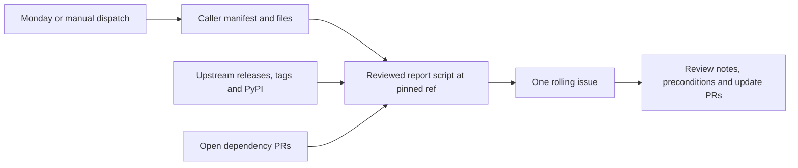

# Pin freshness

The [freshness workflow](../.github/workflows/pin-freshness.yml) runs every Monday
at **08:23 UTC** and supports manual dispatch. It pilots the org-wide plan here.
The operator performs the first real run after merge. A reusable caller supplies
its own manifest and schedule; defining `workflow_call` does not schedule callers.



## Read the rolling issue

The issue contains outdated exact pins with release links and quoted bump
preconditions, cross-file drift, lookup/extraction failures, and dependency-update
PRs open **longer than seven days**, measured from creation in UTC. A PR qualifies
with the `dependencies` label or a recognized dependency-bot author, including
draft PRs. Exactly seven days does not qualify. Nothing merges or closes a PR.

Compatibility floors are listed separately with the latest stable release. A
minimum, partial runtime selection or generated fixture constraint requires a
compatibility decision; a newer release alone does not justify raising it.
Floating runner labels and service model/API identifiers remain visible in
**Manual review selections**: these are not numeric package releases. Their source
repository provides context; the script does not claim to validate a service
catalog using a release API. Consult the service's current catalog/reference.

Drift means repeated selections disagree, including docs, SHA/comment pairs in hook
configs, and shared asset checksums. Distinct scanner roles remain separate pins
(for example the app scan and container scan). Hash comparisons cover identical
assets only; different architectures legitimately have different hashes. The
report does not download or authenticate a new binary or container digest: carry
out the quoted verification procedure before changing its version and digest.

The issue is identified by this exact standalone hidden body line, never its title:

```html
<!-- pin-freshness:rolling-report:v1 -->
```

Only issues created by `github-actions[bot]` match in workflow runs. Local write
mode uses the token's authenticated user identity from the API instead. The issue
query is filtered by creator and each returned author is checked, so another
user's copy of the marker cannot hijack or block the report.

Keep the marker when renaming the issue. Each successful write replaces its body;
put durable discussion in comments. The script searches open and closed issues,
preserves their state, and never closes or reopens one. More than one matching
issue fails rather than choosing arbitrarily. Removing the marker causes the next
run to create a new issue. Repository-scoped workflow concurrency serializes writes.

An upstream/extraction/PR lookup failure is included in the report and makes the
process exit `1`, **after** updating the issue in write mode. Configuration or
issue-write errors exit `2`. Outdated pins and drift alone exit `0`; they need
review, rather than implying the report job failed. Inspect the failure section
even when another lookup succeeded. No failure is silently treated as current.

A failure line carries the API's own error message, not just the status code.
Some upstream organizations enforce an IP allow list that rejects tokens from
hosted runners even for their public repositories. When a read is refused for
that reason, the script repeats that one read once without the token; writes are
never retried this way. If the anonymous read also fails, the report shows it.

## Preview locally

Use Python 3.11+ and a token already available in `GITHUB_TOKEN` (or `GH_TOKEN`),
then run from the caller checkout:

```bash
python scripts/pin_freshness.py --repository OWNER/REPOSITORY --dry-run
```

For a script checkout separate from the caller, invoke its script by path and pass
`--root` for the caller checkout. `--manifest` is relative to that root. The script
uses only the standard library and the reviewed `safe_io.py` helper beside it.
`--dry-run` prints the complete issue body, with no file or API writes. Omitting
it creates or updates the rolling issue, so preview before the operator's first
dispatch. Never print a token or include it in a command argument.

## Add a pin

Edit [the JSON manifest](../.github/pin-freshness.json), validated by
[its schema](../schemas/pin-freshness.schema.json). JSON keeps the runtime stdlib-only.
Each entry has a unique `id`, every repeating file and extraction pattern, an
upstream `source`, and an optional `precondition` copied verbatim from repository
guidance. For example:

```json
{
  "id": "example-tool",
  "locations": [
    {"file": "tools.conf", "pattern": "TOOL_VERSION=(?P<value>\\d+\\.\\d+\\.\\d+)"},
    {"file": "docs/tools.md", "pattern": "Tool (?P<value>\\d+\\.\\d+\\.\\d+)"}
  ],
  "source": {"type": "github_releases", "repo": "OWNER/TOOL"}
}
```

Patterns use Python regular expressions with `MULTILINE` and the named group
`value`. Use scoped `(?s:...)` for a specific multiline block. Every match counts;
missing files, empty values and patterns with no match are failures. Match the
setting's context rather than its current number, so a later bump is still found.
Check that a docs pattern cannot accidentally extract another table row's version.
Only literal checkout-relative POSIX paths are allowed; absolute paths, traversal,
`.git`, symlinks and Windows reparse points are rejected.

Supported automated sources are:

- `github_releases`, with `repo: OWNER/REPO`: published stable releases; drafts and
  prereleases are excluded.
- `github_tags`, with `repo: OWNER/REPO`: stable numeric tags and their commit SHAs.
  Use this for hook revisions, or repositories that do not publish releases.
- `pypi`, with `package: NAME`: stable numeric releases with at least one non-yanked
  distribution file. Prereleases, empty releases and wholly yanked releases are excluded.

GitHub sources accept `tag_pattern`, a full-match regex with a named `version`
group, for prefixes such as `tool-v1.2.3`. The default accepts `v1.2.3` or `1.2.3`.
Numeric components compare numerically; leading `v`, trailing zero components and
build metadata do not change ordering. Unsupported current version syntax is a
reported failure. All API lists are paginated; exceeding the safety limit fails
explicitly. GitHub stops list pagination at 1,000 results. When a `github_releases`
or `github_tags` lookup reaches that cap, the script reads every tag ref of the
repository in one unpaginated request and takes the highest stable version from
the complete set, so a truncated list never decides "latest". For a
`github_releases` source, the highest tags are then checked against their release
records, newest first: a tag with no published release, or whose release is a draft
or prerelease, is skipped, and if none of the 20 highest qualifies the lookup is
reported as incomplete. Versions from a `github_tags` fallback link to the tag. For SHA pins, only lightweight
tags map to a commit there: a pin whose tag is annotated is reported as having no
stable upstream tag. Other lists (such as the dependency-update PR lookup) still
fail explicitly at the cap. Results and failures are cached per source for the
duration of one run.
GitHub credentials go only to the GitHub API; redirects are rejected.

For SHA-pinned hooks, include both the revision and its version comment as
locations in one entry. Tag lookup resolves the SHA to a stable version; an
unmapped SHA is a failure. A major alias cannot override a newer exact tag at the
same commit. This reveals a comment/revision disagreement without changing a pin.

Optional `mirrors` are arrays of `{ "id": "asset-sha256", "locations": [...] }`
with the same location format. They compare raw integrity values across files,
independently of numeric versions. Add a separate mirror per architecture/asset.
The default `policy` is `exact`; `minimum` reports a compatibility selection without
classifying it as an outdated installation. `manual` requires `review_reason`,
extracts values and detects drift, but performs no numeric upstream lookup.

This manifest covers the inventory's scanner engines/plugins, installed package
strings, hook revisions, Bun, schema URL, action config mirrors, inactive login
example, runtime/floor selections and generated integration constraints. It also
keeps floating runner and service identifiers and the Pester compatibility cap
visible. The checkout example in the active review styleguide is monitored beside
its workflow anchors; its Python language floor is a separate compatibility role.
Active Actions are handled by the dependency updater. Release-managed platform references, the documented
historical workaround, captured scanner evidence, old specifications/research and
transitive SDK/CLI measurements remain historical; they are not new upgrade targets.
The inventory snapshot itself is not an executable pin source.

After editing the manifest, run:

```bash
python -m pytest tests/python/test_pin_freshness.py -v --tb=short
python scripts/pin_freshness.py --repository OWNER/REPOSITORY --dry-run
```

The tests validate the checked-in schema and every manifest pattern without any
network access. The dry run verifies real upstreams. Keep failures in the evidence.

## Call from another repository

The implementation is hosted publicly so both public and private callers can use
it. Give the caller a manifest and a workflow like this. This initial example pins
the implementation commit carrying the workflow; after a release, resolve its
reviewed commit and replace **both** SHAs together. Never use `main`.

```yaml
name: Pin freshness
on:
  schedule:
    - cron: '23 8 * * 1'
  workflow_dispatch:
permissions: {}
jobs:
  freshness:
    uses: agenticcodingops/auto-code-scanning/.github/workflows/pin-freshness.yml@802dccfd345272083a934b14a09b6cde850eb10a # initial implementation
    permissions:
      contents: read
      issues: write
      pull-requests: read
    with:
      manifest-path: .github/pin-freshness.json
      issue-title: Weekly pin freshness
      scanning-repo-ref: 802dccfd345272083a934b14a09b6cde850eb10a
```

The workflow checks out caller data in `caller` and this repository's `scripts` at
`scanning-repo-ref` in `platform`. It runs the reviewed script and helpers in Python
isolated mode; caller code and modules are not executed. Inputs pass through
environment variables. Both checkouts disable persisted credentials. Only
`GITHUB_TOKEN` is used, and the issue belongs to the caller's `github.repository`.
The ref default is release-managed, like `reusable-scan.yml`; pass the same SHA as
`uses:` explicitly when pinning a caller. Scheduled/manual pilot runs here use
their own revision. The new file is listed in release-please's `extra-files`.

## Act on updates

The issue is a queue for deliberate updates under the org-wide plan. Read upstream
release notes, assess transitive scanner changes and follow all quoted
preconditions. Patch/minor Actions and scanner updates require a clean review of
the current head, green checks and at least 15 minutes since the push. Majors,
Terraform CLI/providers, runtimes, production-facing workflows and re-measure
preconditions wait for the operator. Other package/runner changes also belong to
the operator unless explicitly delegated. Never infer merge permission from an
empty precondition field.

Use `chore(deps)` for routine update PRs. A scanner-engine or scan-behavior change
uses `fix(deps)` with a release note so consumers receive a release. An update PR
is complete only when merged or deliberately declined; the seven-day section
keeps pending work visible. No automated updater may bypass a precondition.

See the [pin inventory and bump procedures](VERSION-PINNING.md#repository-pin-inventory)
and [contributor checks](CONTRIBUTING.md#run-checks-before-opening-a-pull-request).
API contracts: [releases](https://docs.github.com/en/rest/releases/releases),
[issues](https://docs.github.com/en/rest/issues/issues),
[reusable workflows](https://docs.github.com/en/actions/how-tos/reuse-automations/reuse-workflows)
and [PyPI JSON](https://docs.pypi.org/api/json/).
