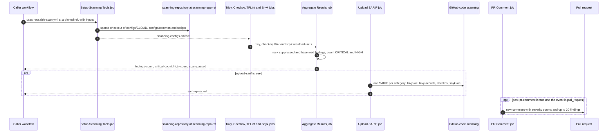

# Reusable Workflows

Use this reference when writing or reviewing a caller workflow.

The current release is `v3.1.2`. <!-- x-release-please-version -->

Sources are named by **job and step**, as they appear in the workflow file and in the
Actions log (for example "the `aggregate` job's `Aggregate and filter results` step").
Job and step names do not move when lines are added, so these references stay valid.
Workflow files such as `reusable-scan.yml` are under `.github/workflows/`; other paths
are relative to the repository root.

Schema 2.0, trusted-base policy, mandatory scanner health and compatibility opt-ins
are described in [CONSUMER-MIGRATION.md](CONSUMER-MIGRATION.md#scan-policy-and-occurrence-approval-migration).
Upgrade hooks and scripts together.

## Choose a workflow

| Workflow | What it does | Caller template |
|---|---|---|
| `reusable-scan.yml` | Scans Terraform with Trivy (misconfigurations and secrets), Checkov, TFLint and, optionally, Snyk IaC. Gates on CRITICAL and HIGH findings, uploads SARIF and comments on the pull request. | `templates/workflows/terraform-scan.yml` |
| `code-security-scan.yml` | Scans C# and TypeScript with Semgrep, and the whole checkout with a Trivy secret scan. Uploads SARIF. | `templates/workflows/code-security-scan.yml` |
| `autonomous-fix.yml` | Proposes a minimal fix to an opted-in pull request in one job. A second job runs the optional build command on the patched code and holds no secret. A third runs no project code: it re-checks the patch with the path gate and a Trivy secret scan of the changed files, then commits and pushes exactly what it checked. It runs no IaC or code scan of its own. | `templates/fix-loop/autonomous-fix.yml` |
| `pin-freshness.yml` | Reports hand-kept versions, drift, failed lookups and dependency PRs open longer than seven days in one rolling issue. | [Pin freshness caller example](PIN-FRESHNESS.md#call-from-another-repository) |

For a worked Terraform example, see [TERRAFORM-MODULE-ADOPTION.md](TERRAFORM-MODULE-ADOPTION.md).
For complete example repositories, see [examples/](../examples/).

## Pin freshness workflow

`pin-freshness.yml` runs in this repository on Mondays at 08:23 UTC and supports
`workflow_dispatch` and `workflow_call`. Reusable callers supply `manifest-path`
(default `.github/pin-freshness.json`), `issue-title` (default `Weekly pin freshness`)
and `scanning-repo-ref` (set it to the same full SHA as the workflow `uses:` pin).
The caller's files are data; the report script comes from this public repository
at the reviewed ref. The job needs `contents: read`, `issues: write` and
`pull-requests: read`, using only `GITHUB_TOKEN`. It changes one marker-identified
issue and preserves its state. See the [runbook](PIN-FRESHNESS.md) for the manifest
schema, preview command, report semantics and a minimal caller pinned by SHA.

## How a Terraform scan runs

The diagram shows one call of `reusable-scan.yml`, from the caller to the SARIF upload
and the pull request comment.



The jobs, in order: `setup` (Setup Scanning Tools), `scan-trivy` (Trivy IaC Scan),
`scan-checkov` (Checkov Policy Scan), `scan-tflint` (TFLint Scan), `scan-snyk` (Snyk IaC
Scan (Optional)), `aggregate` (Aggregate Results), `sarif-upload` (Upload SARIF),
`pr-comment` (PR Comment) and `metrics` (Upload Metrics). The config repository
defaults to the published platform; select a reviewed mirror explicitly with
`scanning-repository`.

## Before you call any of them

### Pin the call

- Pin `uses:` to a release tag or a full commit SHA. Never use `@main`. See
  [VERSION-PINNING.md](VERSION-PINNING.md).
- The `uses:` ref selects the workflow file only. `reusable-scan.yml` checks out its
  configs and helper scripts from `scanning-repository` at `scanning-repo-ref` (the
  `setup` job's `Checkout scanning repo configs` step). `autonomous-fix.yml` checks out
  its scripts from `scanning_repo` at `scanning_repo_ref` (the `Checkout shared
  scanning scripts (pinned)` steps in its `analyze` and `apply-and-push` jobs). Set
  that input to the same tag or commit as `uses:`.
- `code-security-scan.yml` packages its policy helper from its own file, so it has no
  repository or ref input.
- To move to a new release, follow [BUMP-THE-SCAN.md](BUMP-THE-SCAN.md).

### Grant permissions on the calling job

A called workflow can keep or reduce the `GITHUB_TOKEN` permissions it receives. It
cannot raise them ([GitHub Docs: Reusing workflow configurations][gh-reuse]). If a job in
the called workflow asks for more than the calling job grants, GitHub rejects the call.
This repository's own callers grant the permissions even for jobs they switch off (the
calling job in `reusable-scan-self-test.yml`). Each section below lists what to grant.

### Concurrency

`reusable-scan.yml` and `code-security-scan.yml` both set
`group: ${{ github.workflow }}-${{ github.ref }}` with `cancel-in-progress: true` in
their top-level `concurrency:` block. In a called workflow, the `github` context is
the caller's ([GitHub Docs: Reusing workflow configurations][gh-reuse]). So:

- Two calls from the same caller workflow on the same ref compute the same group. With
  `cancel-in-progress: true`, a new run in a group cancels the one in progress
  ([GitHub Docs: Control the concurrency of workflows and jobs][gh-concurrency]). This
  includes a `strategy.matrix` over one call. Put each call in its own caller workflow
  file, with its own `name:`.
- Do not give the caller workflow the group `${{ github.workflow }}-${{ github.ref }}`.
  It equals the called workflow's group, and GitHub cancels the run as a concurrency
  deadlock (see the header comment in `release-verify.yml`).

`autonomous-fix.yml` uses the group `autonomous-fix-<pr_number>` with
`cancel-in-progress: false`: a running fix for a pull request is never cancelled. GitHub
keeps at most one pending run per group, so a newer request for the same pull request
replaces a pending one; not every queued request runs.

## `reusable-scan.yml`

Terraform and IaC scan, called through `workflow_call`.

### Inputs

| Input | Type | Required | Default | What it does | Source |
|---|---|---|---|---|---|
| `terraform-directory` | string | no | `.` | Directory to scan. Trivy's misconfiguration scan and Snyk scan it. Checkov scans it too, but skips any path that contains `examples` or `tests` (`skip-path` in `configs/<cloud>/.checkov.yaml`). TFLint runs once in every directory under it that holds a `.tf` file. | `scan-trivy`, `scan-checkov`, `scan-snyk` jobs; `scan-tflint` job's `Run TFLint` step |
| `cloud-provider` | string | yes | none | `aws`, `azure` or `gcp`. Selects `configs/<cloud>/` for Checkov, TFLint and the policy overlay, and names the metrics artifact. Any other value fails the setup job: there is no `configs/<value>/.checkov.yaml` to copy. | `setup` job's `Checkout scanning repo configs` and `Copy configs to .scanning/configs` steps |
| `severity` | string | no | `CRITICAL,HIGH` | Severity filter for Trivy's misconfiguration scan only. The Trivy secret scan always uses `HIGH,CRITICAL`. Checkov and TFLint do not read it. The gate counts CRITICAL and HIGH whatever you set. | `scan-trivy` job's `Run Trivy IaC scanner` and `Run Trivy secret scanner` steps |
| `scanning-repository` | string | no | `agenticcodingops/auto-code-scanning` | Repository to read configs and helper scripts from. Set it explicitly when you call a fork or a reviewed mirror. | `setup` job's `Checkout scanning repo configs` step |
| `scanning-repo-ref` | string | no | the pinned revision's own release tag | Tag, branch or SHA of `scanning-repository` to read the configs and helper from. Release-please sets the default to the release's own tag, so an unset input reads the configs of the same release as the workflow. Releases before v2.3.4 default to `v1.0.0`, which is not a tag, so callers pinned to them must set it. Set it explicitly whenever you pin `uses:` to a commit SHA. | `setup` job's `Checkout scanning repo configs` step |
| `fail-on-findings` | boolean | no | `true` | When `true`, the Aggregate Results job fails if a CRITICAL or HIGH finding remains after suppressions and the baseline. When `false`, findings do not fail it; scanner and report health remain mandatory. | `aggregate` job's `Aggregate and filter results` step (`FAIL_ON_FINDINGS` in `scripts/aggregate_scan.py`) |
| `upload-sarif` | boolean | no | `true` | Runs the Upload SARIF job. | `sarif-upload` job's `if:` |
| `allow-sarif-upload-errors` | boolean | no | `false` | Explicitly tolerate code-scanning delivery errors; scanner and report health remain mandatory. | `sarif-upload` job |
| `post-pr-comment` | boolean | no | `true` | Runs the PR Comment job. It runs only on `pull_request` events and posts a new comment on every run. | `pr-comment` job's `if:` and `Post PR comment` step |
| `apply-suppressions` | boolean | no | `true` | Marks findings listed in the suppression registry of the trusted base as suppressed. See [Suppressions and baseline](#suppressions-and-baseline). | `aggregate` job |
| `checkov-skip-checks` | string | no | `""` | Comma-separated built-in Checkov IDs, with no spaces. Merges with the cloud config's `skip-check` list and deduplicates. Each consumer ID must match `^CKV2?_[A-Z0-9]+_[0-9]+$`; invalid IDs fail setup with the offending value. | `setup` job's `Validate Checkov consumer settings` step; `scripts/checkov-consumer-options.py` |
| `checkov-render-iter-count` | string | no | `""` | Positive integer. Exports `RENDER_EDGES_DUPLICATE_ITER_COUNT` for the Checkov action step only. Empty leaves it unset; invalid values fail setup. | Same as above |
| `apply-baseline` | boolean | no | `true` | Marks findings listed in `.scan-baseline/baseline.json` of the trusted base as baselined. | `aggregate` job |
| `allow-legacy-exceptions` | boolean | no | `false` | Explicit schema 1.0 migration opt-in. | `scripts/scan_policy.py` |
| `allow-inline-checkov-skips` | boolean | no | `false` | Honour all source inline skips when explicitly requested by the trusted caller. The default honours only unchanged skips already on the same resource in trusted base policy. | `scripts/scan_policy.py` |
| `enable-snyk` | boolean | no | `false` | Runs the Snyk IaC job. Needs the `SNYK_TOKEN` secret. The job installs `snyk@1.1308.4` from npm, an exact version. | `scan-snyk` job's `Install Snyk CLI` step |
| `upload-metrics` | boolean | no | `true` | Uploads the artifact `scan-metrics-<cloud-provider>-<run_id>`, kept for 90 days. | `metrics` job |

To use the Checkov inputs, add them to the caller's `with:` block and keep
`scanning-repo-ref` equal to the workflow call's ref:

```yaml
checkov-skip-checks: "CKV_AZURE_35,CKV2_AZURE_1,CKV_TF_1"
checkov-render-iter-count: "20"
```

The effective skip list and render setting are printed in the setup job summary.
Both inputs default to empty, which keeps the default scanner selection and render
behaviour. The accepted ID families are listed in the
[Checkov Terraform policy index](https://www.checkov.io/5.Policy%20Index/terraform.html).

### Outputs

| Output | Value |
|---|---|
| `findings-count` | Number of active findings, of every severity. Active means neither suppressed nor baselined. Trivy secret findings are included. |
| `critical-count` | Number of active CRITICAL findings. |
| `high-count` | Number of active HIGH findings. |
| `scan-passed` | `true` only when required scanner reports are healthy and either no active CRITICAL/HIGH finding remains or `fail-on-findings` is `false`. Otherwise `false`. |
| `sarif-uploaded` | `true` when at least one of the four SARIF uploads succeeded, otherwise `false` (the `sarif-upload` job's `Set upload output` step). Empty when `upload-sarif` is `false`, because the job does not run. |

The first four come from the `aggregate` job's `Aggregate and filter results` step.

### Secrets

| Secret | Required | What it is for |
|---|---|---|
| `SNYK_TOKEN` | no | Snyk API token. Used only when `enable-snyk` is `true`, by the `scan-snyk` job. |

### Permissions to grant on the calling job

| Permission | Needed by |
|---|---|
| `contents: read` | every job (top-level `permissions:`) |
| `actions: read` | `sarif-upload` job (reads the workflow run in private repositories) |
| `security-events: write` | `sarif-upload` job |
| `pull-requests: write` | `pr-comment` job |

Grant all four permissions even when you turn the SARIF or comment job off: the jobs
declare them whether or not they run.

### What a run produces

- **Code scanning categories:** `trivy-iac`, `trivy-secrets`, `checkov` and `snyk-iac`
  (the four `Upload ... SARIF` steps of the `sarif-upload` job). No input changes them.
  For one commit, a later upload with the same tool and category overwrites the earlier
  results, and two such uploads in one workflow run fail it ([GitHub Docs: Uploading a
  SARIF file to GitHub][gh-sarif]). So two calls of this workflow on the same commit,
  for example one per cloud, keep only one call's results in code scanning. TFLint
  results are not uploaded to code scanning. When a SARIF file is over 25 MB or holds
  more than 5,000 results, each run in it keeps its 5,000 most severe results and then
  gets one `scan-truncation-warning` result, so a run can hold 5,001 results and a
  file with several runs can hold more (the `Truncate SARIF if needed` step).
- **Pull request comment:** a "Security Scan Results" comment with counts per severity,
  the number suppressed and baselined, and up to 20 active findings, most severe first
  (the `pr-comment` job's `Post PR comment` step).
- **Artifacts kept for 1 day:** `scanning-configs`, `trivy-results`, `checkov-results`,
  `tflint-results`, `snyk-results` (when Snyk runs) and `aggregated-results`.
  `aggregated-results` holds `aggregated.json`, which lists every finding with its
  `tool`, `rule_id`, `severity`, `file`, `suppressed` and `baseline` fields.
- **Job summaries:** the Trivy version and the digest of its checks bundle
  (`Show Trivy version`), and the TFLint version with each ruleset version
  (`Show TFLint version`). The setup summary also records the effective Checkov
  skip list and render setting.

### Behaviour to know

#### Configs come from the reviewed platform revision

The setup job fetches `scanning-repository`, defaulting to the published platform
repository, at `scanning-repo-ref`. Set `scanning-repository` explicitly for a fork or
a reviewed mirror; otherwise the configs and helpers come from upstream even when
`uses:` points at your fork. Keep its ref aligned with the workflow revision. Setup
packages helpers and configuration into one artifact, so aggregation uses the same
helper revision as the scanner jobs. The caller token must be able to read any
selected mirror; public platform access needs no additional credentials.

#### The gate counts CRITICAL and HIGH only

With `fail-on-findings: true`, the default, active CRITICAL and HIGH findings fail the
Aggregate Results job. MEDIUM and LOW findings are reported in the comment and SARIF,
but never fail it. How each tool's severity is mapped, in `scripts/aggregate_scan.py`:

| Tool | Severity used |
|---|---|
| Trivy | Trivy's own severity. |
| Checkov | The report's `severity`, or HIGH when it has none. Missing severity metadata does not weaken the gate. |
| TFLint | Rule severity `error` becomes HIGH, `warning` MEDIUM, `notice` LOW (`tflint_severity_map`). A TFLint rule at `error` level counts toward the gate. |
| Snyk | `critical`, `high`, `medium`, `low` map to the same level (`snyk_severity_map`). |

#### Scanner health and secret findings

The aggregate counts secret findings alongside IaC findings. It runs after every
scan job, checks all required job results, validates each required report and
rejects scanner/parser errors. Missing or malformed reports cannot produce a
successful aggregate, even with `fail-on-findings: false`.

#### Scanner configuration

The platform's reviewed cloud config and explicit caller skip lists remain in
effect. Scanner ignore and configuration files are read from the **trusted base**
before scans: the exact base commit of the pull request, which has already been
reviewed and merged, never the pull request's own changes. Inline Terraform skips are
honoured when the same check ID and justification already exist on the same resource
in the same file at that trusted base. New or edited skips remain active findings and
visible SARIF records until approved through schema-2.0 base policy. Deleted skips
cannot hide failed checks. `allow-inline-checkov-skips: true` explicitly honours all
source skips in trusted IaC callers. See
[suppression governance](SUPPRESSION-GOVERNANCE.md#scan-policy-and-occurrence-approval-migration).

#### Suppressions and baseline

CI reads the configured registry and `.scan-baseline/baseline.json` from a separate
trusted-base checkout (the `aggregate` job's `Checkout trusted base policy` step). Both
use schema 2.0 occurrence fingerprints: each entry names exactly one finding. Registry
validation is mandatory; invalid entries fail the gate as a unit. `file_pattern`
further restricts a match. See [SUPPRESSION-GOVERNANCE.md](SUPPRESSION-GOVERNANCE.md)
for the approval floor, expiry checks and migration options.

#### SARIF delivery

SARIF delivery failures fail the Upload SARIF job by default when uploads are enabled.
For repositories that deliberately tolerate optional delivery errors, set
`allow-sarif-upload-errors: true`; this does not relax scanner or report validation.
Missing reports are already rejected by the aggregate and are not uploaded.

## `code-security-scan.yml`

Application-code scan, called through `workflow_call`. For the scan-config side, see
[APP-CODE-SCANNING.md](APP-CODE-SCANNING.md). The jobs are `detect` (Detect languages),
`semgrep` (Semgrep (`<language>`), one per language) and `secrets` (Secret scan).

App-code policy helpers are packaged by the pinned workflow itself (the `detect` job's
`Package workflow policy helper` step) and shared as a run-local artifact under a
unique name. They need no additional helper repository or version input.

### Inputs

| Input | Type | Required | Default | What it does | Source |
|---|---|---|---|---|---|
| `languages` | string | no | `""` | Comma-separated: `csharp`, `typescript`. Unsupported values fail detection. When empty, the workflow reads `scan-config.yaml` from the trusted base and scans each of those two languages whose `languages.<name>.enabled` is `true`. If it cannot read that file, detection fails. | `detect` job's `Resolve enabled app-code languages` step |
| `severity` | string | no | `ERROR` | Passed to `semgrep --severity`. Give one level: `INFO`, `WARNING` or `ERROR`. Semgrep reports rules of exactly that level; it is not a minimum. Semgrep 1.184.0 rejects a comma-separated value such as `ERROR,WARNING` with exit code 2 (tested locally): the report step fails rather than substituting an empty report. | `semgrep` job's `Run Semgrep -> SARIF` and `Gate on findings` steps |
| `category-prefix` | string | no | `scan-` | Prefix of the SARIF categories `<prefix>semgrep-<language>` and `<prefix>trivy-secrets`. An empty value becomes `scan-`. When `languages` is empty and `scan-config.yaml` sets `ci.sarif.category_prefix`, that value replaces this input. | `detect` job's `Resolve enabled app-code languages` step |
| `semgrep-version` | string | no | `1.184.0` | Semgrep version installed with pip. | `semgrep` job's `Install Semgrep (pinned)` step |
| `run-secret-scan` | boolean | no | `true` | Runs the Secret scan job: Trivy 0.76.2, secret scanner, CRITICAL and HIGH, over the whole checkout except `node_modules`, `dist`, `build`, `bin`, `obj` and `.terraform`. | `secrets` job |
| `fail-on-findings` | boolean | no | `true` | Adds a gate step to each job. The Semgrep gate fails on any finding at `severity`. The secret gate fails on any CRITICAL or HIGH secret. | `Gate on findings` and `Gate on secret findings` steps |
| `upload-sarif` | boolean | no | `true` | Uploads each job's SARIF to code scanning. An upload error does not fail the job (`continue-on-error: true`). | `Upload SARIF (distinct category)` and `Upload secrets SARIF (distinct category)` steps |

Semgrep uses the registry rulesets `p/csharp` and `p/typescript`, chosen by the
`Map language to ruleset` step. No input changes them. Inline `nosemgrep` comments are
ignored (`--disable-nosem`).

### Outputs

| Output | Value |
|---|---|
| `languages-scanned` | JSON array of the languages scanned, for example `["csharp", "typescript"]`, or `[]`. |

### Secrets

None. The `workflow_call` block declares no secrets.

### Permissions to grant on the calling job

| Permission | Needed by |
|---|---|
| `contents: read` | every job (top-level `permissions:`) |
| `actions: read` | `semgrep` and `secrets` jobs (they declare it, and private SARIF uploads read workflow-run metadata) |
| `security-events: write` | `semgrep` and `secrets` jobs (SARIF upload) |

The `semgrep` and `secrets` jobs each declare `contents: read`, `actions: read` and
`security-events: write`, so grant all three even with `upload-sarif: false`. No job
asks for `pull-requests`, and the workflow posts no pull request comment; the shipped
caller template still grants `pull-requests: write`, which does no harm.

## `autonomous-fix.yml`

Opt-in fix loop, called through `workflow_call`. Read [FIX-LOOP.md](FIX-LOOP.md) and
[SECURITY-MODEL.md](SECURITY-MODEL.md) before you turn it on. The caller workflow
decides who can start it; the template's `if:` on its `fix` job is that boundary. The
workflow itself also refuses to run when the review, the comment or the run was made by
the shared `github-actions[bot]` identity, which every workflow's `GITHUB_TOKEN` acts
as (the `config` job's `Refuse triggers from the shared workflow identity` step).

The jobs are `config` (Read fix_loop config), `analyze` (Analyze and propose patch),
`verify` (Build verify (no credentials)), `apply-and-push` (Gate, scan, commit, push)
and `flag-human-review` (Flag for human review).

### Inputs

| Input | Type | Required | Default | What it does | Source |
|---|---|---|---|---|---|
| `pr_number` | string | yes | none | Pull request to fix. Must be digits only. A pull request from a fork is refused. | `analyze` job's `Resolve PR context` step |
| `config_path` | string | no | `scan-config.yaml` | Path of the config in your repository. It is read from the pull request's base commit, or from the default branch on `workflow_dispatch`, never from the pull request head. The jobs after `config` run only when its `fix_loop.enabled` is `true`. | `config` job's `Checkout TRUSTED base config (NEVER the PR head)` and `Parse fix_loop (from trusted base config)` steps |
| `scanning_repo` | string | no | `agenticcodingops/auto-code-scanning` | Repository to check out the shared scripts from; the path gate runs `scripts/check-fix-allowlist.py` from it. Set it when you call a fork or mirror. | `Checkout shared scanning scripts (pinned)` steps |
| `scanning_repo_ref` | string | no | the pinned revision's own release tag | Ref of `scanning_repo` to check out. Set it to the same tag or commit as `uses:`. | Same as above |

### Outputs

None. The `workflow_call` block declares no outputs.

### Secrets

| Secret | Required | What it is for |
|---|---|---|
| `AUTOFIX_TOKEN` | yes | Used only by the `apply-and-push` job's `Push the vetted commit` step, to push to the pull request's branch. Its description asks for a fine-grained token with Contents and Pull requests read and write, on your repository only. See [FIX-LOOP.md](FIX-LOOP.md#secrets) for what the push needs. |
| `ANTHROPIC_API_KEY` | no | Key for the `Run Claude Code (FIX-ONLY)` step, the only step that receives it. |
| `CLAUDE_CODE_OAUTH_TOKEN` | no | Alternative to `ANTHROPIC_API_KEY`. |

The workflow does not require either agent credential. The agent step has
`continue-on-error: true`. Without a credential it produces no patch, so the run ends
with no change and does not label the pull request.

### Permissions to grant on the calling job

| Permission | Needed by |
|---|---|
| `contents: read` | `config`, `analyze`, `verify` and `apply-and-push` |
| `pull-requests: write` | `analyze` (`read`) and `flag-human-review` (`write`) |
| `actions: read` | `analyze` |
| `issues: write` | `flag-human-review` |

The current caller template grants exactly these four permissions on its `fix` job and
no workflow-level permissions. Keep these grants: they are the called workflow's
permission ceiling, and its jobs keep their narrower grants. Callers copied from
v2.3.6 or earlier grant only `contents: read` by default; add the four permissions
above to their `fix` job.

## References

- [VERSION-PINNING.md](VERSION-PINNING.md): how to pin, and the scanner versions.
- [BUMP-THE-SCAN.md](BUMP-THE-SCAN.md): move a caller to a new release.
- [TERRAFORM-MODULE-ADOPTION.md](TERRAFORM-MODULE-ADOPTION.md): a complete Terraform
  caller.
- [CONSUMER-MIGRATION.md](CONSUMER-MIGRATION.md): replace inline workflows with callers.
- [GitHub Docs: Reusing workflow configurations][gh-reuse]
- [GitHub Docs: GITHUB_TOKEN][gh-token]
- [GitHub Docs: Control the concurrency of workflows and jobs][gh-concurrency]
- [GitHub Docs: Uploading a SARIF file to GitHub][gh-sarif]

[gh-reuse]: https://docs.github.com/en/actions/reference/workflows-and-actions/reusing-workflow-configurations
[gh-token]: https://docs.github.com/en/actions/concepts/security/github_token
[gh-concurrency]: https://docs.github.com/en/actions/how-tos/write-workflows/choose-when-workflows-run/control-workflow-concurrency
[gh-sarif]: https://docs.github.com/en/code-security/code-scanning/integrating-with-code-scanning/uploading-a-sarif-file-to-github
