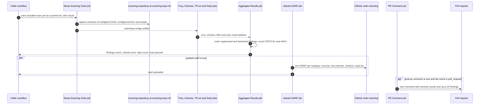

# Reusable Workflows

## Scan policy migration

Schema 2.0, trusted-base policy, mandatory scanner health and compatibility opt-ins
are described in [CONSUMER-MIGRATION.md](CONSUMER-MIGRATION.md#scan-policy-and-occurrence-approval-migration).
Upgrade hooks and scripts together.

Use this reference when writing or reviewing a caller workflow.

The current release is `v3.0.6`. <!-- x-release-please-version -->

Each `file:line` reference on this page refers to the source in this revision.
Workflow file names such as `reusable-scan.yml` and `autonomous-fix.yml` are
under `.github/workflows/`; other paths are relative to the repository root.

## Choose a workflow

| Workflow | What it does | Caller template | Source |
|---|---|---|---|
| `reusable-scan.yml` | Scans Terraform with Trivy (misconfigurations and secrets), Checkov, TFLint and, optionally, Snyk IaC. Gates on CRITICAL and HIGH findings, uploads SARIF and comments on the pull request. | `templates/workflows/terraform-scan.yml` | `reusable-scan.yml:5-6`, `184-539` |
| `code-security-scan.yml` | Scans C# and TypeScript with Semgrep, and the whole checkout with a Trivy secret scan. Uploads SARIF. | `templates/workflows/code-security-scan.yml` | `code-security-scan.yml:5-7`, `126-250` |
| `autonomous-fix.yml` | Proposes a minimal fix to an opted-in pull request in one job. A second job runs the optional build command on the patched code and holds no secret. A third runs no project code: it re-checks the patch with the path gate and a Trivy secret scan of the changed files, then commits and pushes exactly what it checked. It runs no IaC or code scan of its own. | `templates/fix-loop/autonomous-fix.yml` | `autonomous-fix.yml:9-28`, `436-692` |

For a worked Terraform example, see [TERRAFORM-MODULE-ADOPTION.md](TERRAFORM-MODULE-ADOPTION.md).

## How a Terraform scan runs

The diagram shows one call of `reusable-scan.yml`, from the caller to the SARIF upload
and the pull request comment.



Sources: setup job `reusable-scan.yml:123-179`; scan jobs `184-539`; Aggregate
`545-833`; Upload SARIF `839-970`; PR Comment `976-1063`; workflow outputs `90-105`.
The config repository defaults to the published platform. Select a reviewed mirror
explicitly with `scanning-repository`.

## Before you call any of them

### Pin the call

- Pin `uses:` to a release tag or a full commit SHA. Never use `@main`. See
  [VERSION-PINNING.md](VERSION-PINNING.md).
- The `uses:` ref selects the workflow file only. `reusable-scan.yml` checks out its
  configs from the `scanning-repo-ref` input (`reusable-scan.yml:135-143`), and
  `autonomous-fix.yml` checks out its scripts from `scanning_repo_ref`
  (`autonomous-fix.yml:251-257`, `520-526`). Set that input to the same tag or commit as
  `uses:`.
- To move to a new release, follow [BUMP-THE-SCAN.md](BUMP-THE-SCAN.md).

### Grant permissions on the calling job

A called workflow can keep or reduce the `GITHUB_TOKEN` permissions it receives. It
cannot raise them ([GitHub Docs: Reusing workflow configurations][gh-reuse]). If a job in
the called workflow asks for more than the calling job grants, GitHub rejects the call.
This repository's own callers grant the permissions even for jobs they switch off
(`reusable-scan-self-test.yml:135-140`). Each section below lists what to grant.

### Concurrency

`reusable-scan.yml` and `code-security-scan.yml` both set
`group: ${{ github.workflow }}-${{ github.ref }}` with `cancel-in-progress: true`
(`reusable-scan.yml:114-116`, `code-security-scan.yml:69-71`). In a called workflow, the
`github` context is the caller's ([GitHub Docs: Reusing workflow configurations][gh-reuse]).
So:

- Two calls from the same caller workflow on the same ref compute the same group. With
  `cancel-in-progress: true`, a new run in a group cancels the one in progress
  ([GitHub Docs: Control the concurrency of workflows and jobs][gh-concurrency]). This
  includes a `strategy.matrix` over one call. Put each call in its own caller workflow
  file, with its own `name:`.
- Do not give the caller workflow the group `${{ github.workflow }}-${{ github.ref }}`.
  It equals the called workflow's group, and GitHub cancels the run as a concurrency
  deadlock (`release-verify.yml:18-24`).

`autonomous-fix.yml` uses the group `autonomous-fix-<pr_number>` and never cancels a run
in progress (`autonomous-fix.yml:80-82`).

## `reusable-scan.yml`

Terraform and IaC scan. Called through `workflow_call` (`reusable-scan.yml:23-24`).

### Inputs

| Input | Type | Required | Default | What it does | Source |
|---|---|---|---|---|---|
| `terraform-directory` | string | no | `.` | Directory to scan. Trivy's misconfiguration scan and Snyk scan it. Checkov scans it too, but skips any path that contains `examples` or `tests` (`skip-path` in `configs/<cloud>/.checkov.yaml`). TFLint runs once in every directory under it that holds a `.tf` file. | `reusable-scan.yml:26-30`, `204`, `233`, `301`, `425-439`, `513`, `524`; `configs/azure/.checkov.yaml:52-58` |
| `cloud-provider` | string | yes | none | `aws`, `azure` or `gcp`. Selects `configs/<cloud>/` for Checkov, TFLint and the policy overlay, and names the metrics artifact. Any other value fails the setup job: there is no `configs/<value>/.checkov.yaml` to copy. | `reusable-scan.yml:31-34`, `142`, `154-156`, `1140` |
| `severity` | string | no | `CRITICAL,HIGH` | Severity filter for Trivy's misconfiguration scan only. The Trivy secret scan always uses `HIGH,CRITICAL`. Checkov and TFLint do not read it. The gate counts CRITICAL and HIGH whatever you set. | `reusable-scan.yml:35-39`, `205`, `234`, `247`, `260`, `808-812` |
| `scanning-repository` | string | no | `agenticcodingops/auto-code-scanning` | Published platform repository; set explicitly for a reviewed mirror. | `reusable-scan.yml` |
| `scanning-repo-ref` | string | no | the pinned revision's own release tag | Tag, branch or SHA of `scanning-repository` (the published platform repository by default) to read the configs and helper from. The default lives inside the workflow revision that `uses:` pins: release-please sets it to that release's tag, so an unset input reads the configs of the same release as the workflow. Releases before the one that carries this change default to `v1.0.0`, which is not a tag, so callers pinned to them must set it. Set it explicitly whenever it must differ from `uses:`. | `reusable-scan.yml:40-44`, `135-143` |
| `fail-on-findings` | boolean | no | `true` | When `true`, the Aggregate Results job fails if a CRITICAL or HIGH finding remains after suppressions and the baseline. When `false`, findings do not fail it; scanner and report health remain mandatory. | `reusable-scan.yml:45-49`, `572`, `807-812`, `841-842` |
| `upload-sarif` | boolean | no | `true` | Runs the Upload SARIF job. | `reusable-scan.yml:50-54`, `865` |
| `allow-sarif-upload-errors` | boolean | no | `false` | Explicitly tolerate code-scanning delivery errors; scanner and report health remain mandatory. | `reusable-scan.yml` |
| `post-pr-comment` | boolean | no | `true` | Runs the PR Comment job. It runs only on `pull_request` events and posts a new comment on every run. | `reusable-scan.yml:55-59`, `1002`, `1076-1081` |
| `apply-suppressions` | boolean | no | `true` | Marks findings listed in `.scan-suppressions.yaml`, at the caller's repository root, as suppressed. See [Suppressions and baseline](#suppressions-and-baseline). | `reusable-scan.yml:60-64`, `570`, `724-775` |
| `checkov-skip-checks` | string | no | `""` | Comma-separated built-in Checkov IDs, with no spaces. Merges with the cloud config's `skip-check` list and deduplicates. Each consumer ID must match `^CKV2?_[A-Z0-9]+_[0-9]+$`; invalid IDs fail setup with the offending value. | `reusable-scan.yml:65-69`; `scripts/checkov-consumer-options.py` |
| `checkov-render-iter-count` | string | no | `""` | Positive integer. Exports `RENDER_EDGES_DUPLICATE_ITER_COUNT` for the Checkov action step only. Empty leaves it unset; invalid values fail setup. | `reusable-scan.yml:70-74`; `scripts/checkov-consumer-options.py` |
| `apply-baseline` | boolean | no | `true` | Marks findings listed in `.scan-baseline/baseline.json` as baselined. | `reusable-scan.yml:75-79`, `571`, `777-791` |
| `allow-legacy-exceptions` | boolean | no | `false` | Explicit schema 1.0 migration opt-in. | `scan_policy.py` |
| `allow-inline-checkov-skips` | boolean | no | `false` | Honour all source inline skips when explicitly requested by the trusted caller. The default honours only unchanged skips already on the same resource in trusted base policy. | `scan_policy.py` |
| `enable-snyk` | boolean | no | `false` | Runs the Snyk IaC job. Needs the `SNYK_TOKEN` secret. The job installs `snyk@1.1307.4` from npm (an exact version; before this it installed whatever npm called latest, up to and including v2.3.2). | `reusable-scan.yml:80-84`, `497`, `507-508` |
| `upload-metrics` | boolean | no | `true` | Uploads the artifact `scan-metrics-<cloud-provider>-<run_id>`, kept for 90 days. | `reusable-scan.yml:85-89`, `1092`, `1137-1142` |

For a release or commit containing these inputs, add the following to the caller's
`with:` block and keep `scanning-repo-ref` equal to the workflow call's ref:

```yaml
checkov-skip-checks: "CKV_AZURE_35,CKV2_AZURE_1,CKV_TF_1"
checkov-render-iter-count: "20"
```

The effective skip list and render setting are printed in the setup job summary.
No upgrade note is needed: both inputs default to empty, preserving today's scanner
selection and render behaviour. The accepted ID families are documented in the
[Checkov Terraform policy index](https://www.checkov.io/5.Policy%20Index/terraform.html).

### Outputs

| Output | Value | Source |
|---|---|---|
| `findings-count` | Number of active findings, of every severity. Active means neither suppressed nor baselined. Trivy secret findings are included. | `reusable-scan.yml:91-93`, `794`, `803`, `828` |
| `critical-count` | Number of active CRITICAL findings. | `reusable-scan.yml:94-96`, `804`, `829` |
| `high-count` | Number of active HIGH findings. | `reusable-scan.yml:97-99`, `805`, `830` |
| `scan-passed` | `true` only when required scanner reports are healthy and either no active CRITICAL/HIGH finding remains or `fail-on-findings` is `false`. Otherwise `false`. | `reusable-scan.yml:100-102`, `807-812`, `831` |
| `sarif-uploaded` | `true` when at least one of the four SARIF uploads succeeded, otherwise `false`. Empty when `upload-sarif` is `false`, because the job does not run. | `reusable-scan.yml:103-105`, `865`, `977-988` |

### Secrets

| Secret | Required | What it is for | Source |
|---|---|---|---|
| `SNYK_TOKEN` | no | Snyk API token. Used only when `enable-snyk` is `true`. | `reusable-scan.yml:106-109`, `512`, `523` |

### Permissions to grant on the calling job

| Permission | Needed by | Source |
|---|---|---|
| `contents: read` | every job | `reusable-scan.yml:111-112` |
| `actions: read` | Upload SARIF (read workflow runs in private repositories) | `reusable-scan.yml` |
| `security-events: write` | Upload SARIF | `reusable-scan.yml:861-863` |
| `pull-requests: write` | PR Comment | `reusable-scan.yml:998-1000` |

Grant all four permissions even when you turn the SARIF or comment job off
(`reusable-scan-self-test.yml:135-140`).

### What a run produces

- **Code scanning categories:** `trivy-iac`, `trivy-secrets`, `checkov` and `snyk-iac`
  (`reusable-scan.yml:945`, `954`, `965`, `974`). No input changes them. For one commit,
  a later upload with the same tool and category overwrites the earlier results, and two
  such uploads in one workflow run fail it ([GitHub Docs: Uploading a SARIF file to
  GitHub][gh-sarif]). So two calls of this workflow on the same commit, for example one
  per cloud, keep only one call's results in code scanning. TFLint results are not
  uploaded to code scanning. When a SARIF file is over 25 MB or holds more than 5,000
  results, each run in it keeps its 5,000 most severe results and then gets one
  `scan-truncation-warning` result, so a run can hold 5,001 results and a file with
  several runs can hold more (`reusable-scan.yml:889-936`).
- **Pull request comment:** counts per severity, the number suppressed and baselined,
  and up to 20 active findings (`reusable-scan.yml:1022-1074`). The table lists the most
  severe first: CRITICAL, HIGH, MEDIUM, LOW (`reusable-scan.yml:1036-1039`). Up to v2.3.0
  its sort applied `|| 4` to CRITICAL's rank of `0`, so CRITICAL findings sorted after LOW,
  and a run with 20 or more other findings showed none in the table. The counts above the
  table were always right.
- **Artifacts kept for 1 day:** `scanning-configs`, `trivy-results`, `checkov-results`,
  `tflint-results`, `snyk-results` (when Snyk runs) and `aggregated-results`
  (`reusable-scan.yml:171-179`, `265-275`, `350-358`, `480-486`, `531-539`, `845-851`).
  `aggregated-results` holds `aggregated.json`, which lists every finding with its
  `tool`, `rule_id`, `severity`, `file`, `suppressed` and `baseline` fields
  (`reusable-scan.yml:633-722`, `814-824`).
- **Job summaries:** the Trivy version and the digest of its checks bundle
  (`reusable-scan.yml:213-225`), and the TFLint version with each ruleset version
  (`reusable-scan.yml:407-419`). The setup summary also records the effective Checkov
  skip list and render setting (`scripts/checkov-consumer-options.py`).

### Behaviour to know

#### Configs come from the reviewed platform revision

The setup job fetches `scanning-repository`, defaulting to the published platform
repository, at `scanning-repo-ref`. Set `scanning-repository` explicitly for a
reviewed mirror. Keep its ref aligned with the workflow revision. Setup packages
helpers and configuration into one artifact, so aggregation uses the same helper
revision as the scanner jobs. The caller token must be able to read any selected
mirror; public platform access needs no additional credentials.

#### The gate counts CRITICAL and HIGH only

With `fail-on-findings: true`, the default, active CRITICAL and HIGH findings fail the
Aggregate Results job. MEDIUM and LOW findings are reported in the comment and SARIF, but
never fail it (`reusable-scan.yml:45-49`, `808-812`). How each tool's severity is mapped:

| Tool | Severity used | Source |
|---|---|---|
| Trivy | Trivy's own severity. | `reusable-scan.yml:640` |
| Checkov | The report's `severity`, or HIGH when it has none. Missing severity metadata does not weaken the gate. | `reusable-scan.yml:660-664` |
| TFLint | Rule severity `error` becomes HIGH, `warning` MEDIUM, `notice` LOW. A TFLint rule at `error` level counts toward the gate. | `reusable-scan.yml:682`, `689` |
| Snyk | `critical`, `high`, `medium`, `low` map to the same level. | `reusable-scan.yml:703`, `711` |

#### Scanner health and secret findings

The aggregate counts secret findings alongside IaC findings. It runs after every
scan job, checks all required job results, validates each required report and
rejects scanner/parser errors. Missing or malformed reports cannot produce a
successful aggregate, even with `fail-on-findings: false`.

#### Scanner configuration

The platform's reviewed cloud config and explicit caller skip lists remain in
effect. Scanner ignore/configuration files in the source checkout are materialized
from the exact base SHA before scans. Inline Terraform skips are honoured when
the same check ID and justification already exist on the same resource in the
same file at that trusted base. New or edited skips remain active findings and
visible SARIF records until approved through schema-2.0 base policy. Deleted
skips cannot hide failed checks. `allow-inline-checkov-skips: true` explicitly
honours all source skips in trusted IaC callers. See
[suppression governance](SUPPRESSION-GOVERNANCE.md#scan-policy-and-occurrence-approval-migration).

#### Suppressions and baseline

CI reads the configured registry and `.scan-baseline/baseline.json` from a separate
trusted-base checkout. Both use schema 2.0 occurrence fingerprints and bounded
counts. Registry validation is mandatory; invalid entries fail the gate as a unit.
`file_pattern` further restricts a match. See [SUPPRESSION-GOVERNANCE.md](SUPPRESSION-GOVERNANCE.md)
for the approval floor, expiry checks and migration options.

## `code-security-scan.yml`

App-code policy helpers are packaged by the pinned workflow itself and distributed
as a run-local artifact. They require no additional helper repository or version input.

Application-code scan. Called through `workflow_call` (`code-security-scan.yml:23-24`).
For the scan-config side, see [APP-CODE-SCANNING.md](APP-CODE-SCANNING.md).

### Inputs

| Input | Type | Required | Default | What it does | Source |
|---|---|---|---|---|---|
| `languages` | string | no | `""` | Comma-separated: `csharp`, `typescript`. Unsupported values fail detection. When empty, the workflow reads `scan-config.yaml` from the trusted base and scans each of those two languages whose `languages.<name>.enabled` is `true`. If it cannot read that file, detection fails. | `code-security-scan.yml:26-30`, `96-115` |
| `severity` | string | no | `ERROR` | Passed to `semgrep --severity`. Give one level: `INFO`, `WARNING` or `ERROR`. Semgrep reports rules of exactly that level; it is not a minimum. Semgrep 1.100.0 rejects a comma-separated value such as `ERROR,WARNING` with exit code 2 (tested locally): the report step fails rather than substituting an empty report. | `code-security-scan.yml:31-35`, `169-179`, `195-200` |
| `category-prefix` | string | no | `scan-` | Prefix of the SARIF categories `<prefix>semgrep-<language>` and `<prefix>trivy-secrets`. An empty value becomes `scan-`. When `languages` is empty and `scan-config.yaml` sets `ci.sarif.category_prefix`, that value replaces this input. | `code-security-scan.yml:36-40`, `97`, `111-113`, `186`, `242` |
| `semgrep-version` | string | no | `1.100.0` | Semgrep version installed with pip. | `code-security-scan.yml:41-45`, `147-151` |
| `run-secret-scan` | boolean | no | `true` | Runs the Secret scan job: Trivy 0.71.0, secret scanner, CRITICAL and HIGH, over the whole checkout except `node_modules`, `dist`, `build`, `bin`, `obj` and `.terraform`. | `code-security-scan.yml:46-50`, `210`, `223-235` |
| `fail-on-findings` | boolean | no | `true` | Adds a gate step to each job. The Semgrep gate fails on any finding at `severity`. The secret gate fails on any CRITICAL or HIGH secret. | `code-security-scan.yml:51-55`, `189-200`, `245-250` |
| `upload-sarif` | boolean | no | `true` | Uploads each job's SARIF to code scanning. An upload error does not fail the job. | `code-security-scan.yml:56-60`, `181-187`, `237-243` |

Semgrep uses the registry rulesets `p/csharp` and `p/typescript`. No input changes them
(`code-security-scan.yml:153-162`).

### Outputs

| Output | Value | Source |
|---|---|---|
| `languages-scanned` | JSON array of the languages scanned, for example `["csharp", "typescript"]`, or `[]`. | `code-security-scan.yml:61-64`, `82`, `116-118` |

### Secrets

None. The `workflow_call` block declares no secrets (`code-security-scan.yml:23-64`).

### Permissions to grant on the calling job

| Permission | Needed by | Source |
|---|---|---|
| `contents: read` | every job | `code-security-scan.yml:66-67` |
| `security-events: write` | Semgrep and Secret scan jobs | `code-security-scan.yml:132-134`, `211-213` |

No job asks for `pull-requests`. The workflow posts no pull request comment.
It uploads one run-local policy-helper artifact per call under a unique name;
the scanner jobs download that same helper.

## `autonomous-fix.yml`

Opt-in fix loop. Called through `workflow_call` (`autonomous-fix.yml:42-43`). Read
[FIX-LOOP.md](FIX-LOOP.md) and [SECURITY-MODEL.md](SECURITY-MODEL.md) before you turn it
on. The caller workflow decides who can start it; the template's `if:` is that boundary
(`templates/fix-loop/autonomous-fix.yml:53-68`). The workflow itself also refuses to run
when the review, the comment or the run was made by the shared `github-actions[bot]`
identity, which every workflow's `GITHUB_TOKEN` acts as (`autonomous-fix.yml:101-118`).

### Inputs

| Input | Type | Required | Default | What it does | Source |
|---|---|---|---|---|---|
| `pr_number` | string | yes | none | Pull request to fix. Must be digits only. A pull request from a fork is refused. | `autonomous-fix.yml:45-48`, `213-242` |
| `config_path` | string | no | `scan-config.yaml` | Path of the config in your repository. It is read from the pull request's base commit, or from the default branch on `workflow_dispatch`, never from the pull request head. The jobs after the config job run only when its `fix_loop.enabled` is `true`. | `autonomous-fix.yml:49-53`, `120-179`, `197` |
| `scanning_repo` | string | no | `agenticcodingops/auto-code-scanning` | Repository to check out the shared scripts from; the path gate runs `scripts/check-fix-allowlist.py` from it. Set it when you call your own copy. | `autonomous-fix.yml:54-58`, `251-257`, `414`, `520-526`, `599` |
| `scanning_repo_ref` | string | no | `v2.0.0` | Ref of `scanning_repo` to check out. Set it to the same tag or commit as `uses:`. | `autonomous-fix.yml:59-63`, `255`, `524` |

### Outputs

None. The `workflow_call` block declares no outputs (`autonomous-fix.yml:42-73`).

### Secrets

| Secret | Required | What it is for | Source |
|---|---|---|---|
| `AUTOFIX_TOKEN` | yes | Used only by the final push step. Its description asks for a fine-grained token with Contents and Pull requests read and write, on your repository only. | `autonomous-fix.yml:65-67`, `675-692` |
| `ANTHROPIC_API_KEY` | no | Key for the coding-agent step, the only step that receives it. | `autonomous-fix.yml:68-70`, `335` |
| `CLAUDE_CODE_OAUTH_TOKEN` | no | Alternative to `ANTHROPIC_API_KEY`. | `autonomous-fix.yml:71-73`, `336` |

The workflow does not require either agent credential. The agent step has
`continue-on-error: true` (`autonomous-fix.yml:376`). Without a credential it produces no
patch, so the run ends with no change and does not label the pull request
(`autonomous-fix.yml:378-401`, `441-444`, `702-710`).

### Permissions to grant on the calling job

| Permission | Needed by | Source |
|---|---|---|
| `contents: read` | Config, Analyze, Verify and Apply-and-push | `autonomous-fix.yml:79-80`, `206`, `454`, `521` |
| `pull-requests: write` | Analyze (`read`) and Flag for human review (`write`) | `autonomous-fix.yml:207`, `728` |
| `actions: read` | Analyze | `autonomous-fix.yml:208` |
| `issues: write` | Flag for human review | `autonomous-fix.yml:727` |

The current caller template grants exactly these four permissions on its `fix` job
(`templates/fix-loop/autonomous-fix.yml:37-41`) and no workflow-level permissions.
Keep these grants: they are the called workflow's permission ceiling, and its jobs
retain their narrower grants. Callers copied from v2.3.6 or earlier grant only
`contents: read` by default; add the four permissions above to their `fix` job.

## References

- [VERSION-PINNING.md](VERSION-PINNING.md): how to pin, and the scanner versions.
- [BUMP-THE-SCAN.md](BUMP-THE-SCAN.md): move a caller to a new release.
- [TERRAFORM-MODULE-ADOPTION.md](TERRAFORM-MODULE-ADOPTION.md): a complete Terraform
  caller.
- [CONSUMER-MIGRATION.md](CONSUMER-MIGRATION.md): replace inline workflows with callers.
- [GitHub Docs: Reusing workflow configurations][gh-reuse]
- [GitHub Docs: GITHUB_TOKEN][gh-token]
- [GitHub Docs: Control the concurrency of workflows and jobs][gh-concurrency]
- [GitHub Docs: Uploading a SARIF file to GitHub][gh-sarif]

[gh-reuse]: https://docs.github.com/en/actions/reference/workflows-and-actions/reusing-workflow-configurations
[gh-token]: https://docs.github.com/en/actions/concepts/security/github_token
[gh-concurrency]: https://docs.github.com/en/actions/how-tos/write-workflows/choose-when-workflows-run/control-workflow-concurrency
[gh-sarif]: https://docs.github.com/en/code-security/code-scanning/integrating-with-code-scanning/uploading-a-sarif-file-to-github

SARIF delivery failures fail the workflow by default when uploads are enabled.
For repositories that deliberately tolerate optional delivery errors, set
`allow-sarif-upload-errors: true`; this does not relax scanner or report validation.
Missing reports are already rejected by the aggregate and are not uploaded.
