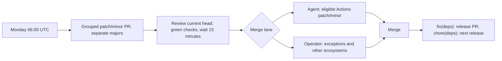

# Version Pinning Guide

How to manage versions of auto-code-scanning in your repository.

The current release is **`v3.1.0`**. <!-- x-release-please-version -->

> **On a release before `v2.1.0`?** Your Terraform scan (`reusable-scan.yml`) did not run Checkov, and TFLint
> linted at most one directory. Read
> [Upgrading from a Release Before 2.1.0](#upgrading-from-a-release-before-210) before you
> bump.

Releases after `v2.1.0` are cut by release-please (see "Release Process" in
[CONTRIBUTING.md](CONTRIBUTING.md)). Each one has a GitHub Release with its notes, a
`CHANGELOG.md` entry, and a **Release Verification** run on its tag whose logs and job
summaries record the exact scanner and ruleset versions it installs. `version.txt` at the
root of each release holds its version.

## Release-managed references and verified downloads

Shipped templates and reusable workflow defaults use release tags with
release-please version markers. Release automation updates the executable tag
at each release. Adopters should replace the tag with the full 40-character commit
that release tag points to, as described below, and pass the same commit as
`scanning-repo-ref` or `scanning_repo_ref`. Review and update these pins together
when upgrading. Scheduled dependency refreshes are tracked in #38.

Direct scanner downloads are locked in `scripts/scanner-downloads.json` with an
exact release URL and a committed SHA-256 checksum for each supported platform.
The installer validates the digest before reading the archive, and copies only
the expected executable. Verify new hashes against the publisher's checksum
source before updating this lock.

## Pin to a Release Tag — Never `@main`

> **MANDATORY.** Consumers **MUST** pin every reference to this repo to a release
> tag (e.g. `@v3.1.0`) or a full 40-character commit SHA. **Never** reference <!-- x-release-please-version -->
> `@main`. This applies to **both**:
>
> - pre-commit `rev:` in `.pre-commit-config.yaml`, and
> - the reusable workflow `uses:` references in `.github/workflows/`
>   (`code-security-scan.yml`, `autonomous-fix.yml`, `reusable-scan.yml`).
>
> `@main` is a moving target: it can change hook behavior, exit-code semantics, or
> the fix-loop privilege boundary under you without warning. A pinned tag/SHA is
> the only reproducible, reviewable reference.

## Pin the Commit a Release Tag Points To

Pin the commit a release tag points to, and name the version in a comment. Pass the same
commit as `scanning-repo-ref`, so the configs match the workflow:

```yaml
jobs:
  iac:
    uses: OWNER/auto-code-scanning/.github/workflows/reusable-scan.yml@<commit-sha> # vX.Y.Z
    with:
      cloud-provider: aws
      scanning-repo-ref: <commit-sha>
```

`reusable-scan.yml` reads configuration from the reviewed platform repository,
`agenticcodingops/auto-code-scanning`, by default. No same-owner copy is required.
Set `scanning-repo-ref` to the same full commit SHA as the workflow pin. A reviewed
mirror needs an explicit `scanning-repository` input and must contain that commit.
Require setup and scanner jobs as well as aggregation; incomplete scans block.
See [workflow configuration sources](REUSABLE-WORKFLOWS.md#configs-come-from-the-reviewed-platform-revision).

Find the commit with `^{commit}`, which peels a tag to the commit it points to:

```bash
# In a clone of this repository
git fetch --tags origin
git rev-parse 'vX.Y.Z^{commit}'

# Without a clone: an annotated tag lists two lines; use the one ending in ^{}
git ls-remote https://github.com/agenticcodingops/auto-code-scanning 'refs/tags/vX.Y.Z*'
```

This works for both kinds of tag here. The tags up to `v2.1.0` were made by hand and are
**annotated**: for them, `git rev-parse vX.Y.Z` without `^{commit}` returns the SHA of the
tag object, which is not a commit and not a valid pin. The tags release-please creates
are **lightweight**, and point straight at the commit.

## How Version Pinning Works

Consuming repos pin to a specific version via the `rev:` field in `.pre-commit-config.yaml`:

```yaml
repos:
  - repo: https://github.com/agenticcodingops/auto-code-scanning
    rev: v3.1.0    # Pinned to exact version — never @main  x-release-please-version
    hooks:
      - id: trivy-iac-critical
      - id: trivy-secrets
      - id: gitleaks
      # v2.0.0 app-code hooks (enable the matching languages.* in scan-config.yaml):
      - id: semgrep-csharp
      - id: semgrep-typescript
      - id: eslint
      - id: prettier
      - id: sqlfluff
      - id: validate-scan-config
```

The `rev:` field accepts:
- **Git tags** (recommended): `v2.0.0`, `v2.1.0`
- **Commit SHAs** (also acceptable): full 40-char SHA for exact reproducibility
- **Branch names** (`main`): **not allowed** — see the rule above

## SemVer Policy

This repository follows Semantic Versioning (SemVer):

| Change Type | Version Bump | Examples |
|-------------|-------------|---------|
| **Breaking** | Major (X.0.0) | Hook ID renamed, exit code semantics changed, removed hook |
| **Feature** | Minor (0.X.0) | New hook added, new script option, new config field |
| **Fix** | Patch (0.0.X) | Bug fix, config correction, documentation update |

> **Note on v2.0.0.** The 2.0.0 release adds the app-code hooks
> (`semgrep-csharp`, `semgrep-typescript`, `dotnet-format`, `dotnet-build`,
> `eslint`, `prettier`, `sqlfluff`, `validate-scan-config`), a second local runner
> (Lefthook, now the default), and the optional Layer-B agentic fix loop. These are
> additive — the existing Terraform hooks and their contracts are unchanged. The
> major bump reflects the platform's evolution from a Terraform-only scan POC into
> a reusable scan→fix platform (and the new `scan-config.yaml` /
> `scan-config.schema.json` becoming the configuration surface).

### What Constitutes a Breaking Change

- Renaming or removing a hook ID (hook IDs are stable contracts)
- Changing exit code meanings (e.g., exit 1 no longer means "findings")
- Removing a script or changing its required arguments
- Changing the structure of `.scanning/last-scan.json` in backward-incompatible ways
- Removing fields from `schemas/unified-results.schema.json`
- Backward-incompatible changes to `scan-config.yaml` / `scan-config.schema.json`
  (e.g. renaming `languages.*.build`, or `fix_loop` required fields)

### What Is NOT a Breaking Change

- Adding new hooks (consumers must opt in by enabling the matching `languages.*`)
- Adding optional parameters to scripts
- Adding fields to JSON schemas (additive)
- Changing tool version minimums (documented in release notes)
- Internal refactoring of hook implementations
- Bumping the centralized `claude-code-action` SHA pin to a newer compatible
  version (documented in release notes)

## Upgrading Versions

To move a workflow caller to a new release, follow [BUMP-THE-SCAN.md](BUMP-THE-SCAN.md).
It moves `uses:` and `scanning-repo-ref` together and records the failed checks before
and after.

### Upgrading from a Release Before 2.1.0

If you pin any release before `v2.1.0` (`v2.0.9` or earlier), `reusable-scan.yml` did not
scan the way its name suggests. The 2.1.0 entry of [CHANGELOG.md](../CHANGELOG.md)
records these failures under its **2.1.0** heading:

- **Checkov never ran.** It rejected the output list it was given, wrote no report, and
  `continue-on-error` kept the job green.
- **TFLint linted at most the scan root.** Every other directory failed to load its
  config, and those errors were dropped.
- **No Checkov finding could reach the pull request comment or the metrics.** The
  Aggregate step read Checkov's JSON at the wrong level.
- Every release before `v2.1.0` used Checkov 2.0.930 and the latest TFLint on each run.
  `v2.0.5` to `v2.0.9` installed Trivy 0.71.0. `v2.0.0` to `v2.0.4` set no Trivy version,
  so `trivy-action` fell back to its default, Trivy 0.65.0, which fails to install on the
  runner, and their TFLint job got no config (the 2.0.5 entry of
  [CHANGELOG.md](../CHANGELOG.md)).

So a passing scan on `v2.0.5` to `v2.0.9` shows only that Trivy found nothing at the
gated severities. On `v2.0.0` to `v2.0.4`, Trivy did not scan at all, so a passing scan
shows nothing. When you move to `v2.1.0` or later:

- Expect findings the scan never showed: TFLint warnings and Checkov failed checks in the
  pull request comment, and Checkov alerts in code scanning (the **2.1.0** entry in
  [CHANGELOG.md](../CHANGELOG.md)).
- In the current workflow, Checkov findings without a severity count as HIGH, and a
  TFLint rule at `error` level also counts as HIGH. Active HIGH findings block when
  `fail-on-findings` is true. See the `Parse Checkov findings` block,
  `tflint_severity_map` and `FAIL_ON_FINDINGS` in
  [aggregate_scan.py](../scripts/aggregate_scan.py). The **2.1.0** changelog entry
  describes the older MEDIUM default for Checkov.
- Checkov uses the platform's `configs/<cloud>/.checkov.yaml` as its base config; the
  `setup` job's `Validate Checkov consumer settings` step in
  [reusable-scan.yml](../.github/workflows/reusable-scan.yml) applies the supported
  consumer inputs. See
  [scanner configuration](REUSABLE-WORKFLOWS.md#scanner-configuration).
- Set `scanning-repo-ref` to the same commit as `uses:`. Unset, it takes
  `on.workflow_call.inputs.scanning-repo-ref.default` in the pinned
  [reusable-scan.yml](../.github/workflows/reusable-scan.yml). Starting with
  **v2.3.4**, each release defaults to its own tag (the **2.3.4** entry in
  [CHANGELOG.md](../CHANGELOG.md)). Earlier releases default to `v1.0.0`, which is
  not a tag. A commit pin therefore needs an explicit value whenever the configs
  at the tag and at the commit differ.

Follow [BUMP-THE-SCAN.md](BUMP-THE-SCAN.md) for the upgrade.

### Automatic Update

```bash
# Update all pre-commit repos to latest tag
pre-commit autoupdate
```

This updates only pre-commit `rev:` fields. It does not upgrade vendored files,
workflow callers or helper pins. Review the target release, resolve its full SHA,
then follow [the coordinated upgrade](SETUP-GUIDE.md#10-upgrade-between-releases)
before committing. Do not treat this command alone as a platform upgrade.

### Manual Update

Edit `.pre-commit-config.yaml` directly:

```yaml
repos:
  - repo: https://github.com/agenticcodingops/auto-code-scanning
    rev: vX.Y.Z    # The release you are moving to
```

### Verify After Upgrade

```bash
# Run all hooks to verify compatibility
pre-commit run --all-files

# Clear cache if hooks behave unexpectedly
pre-commit clean
pre-commit install --hook-type pre-commit
```

Install any other configured non-push hook types explicitly. Leave the push
transaction adapter installed by setup in place; default hook-type settings can
otherwise move it into legacy hook wiring.

Commit-stage security hooks still select the Git index; stage a real test change
and make a scanned commit. Preserve the setup-installed push transaction adapter:
`pre-commit install --hook-type pre-push` alone cannot replace it. Verify push
objects with the [local transaction test](TESTING-GUIDE-CONSUMING-REPO.md#push-transaction-without-a-network-push).

## CI/CD Workflow Pinning

The reusable GitHub Actions workflows are pinned the same way, with `@<tag>` (or a
full SHA) — **never `@main`**. Put each call in its own caller workflow file; two calls
from one caller workflow share a concurrency group (see
[REUSABLE-WORKFLOWS.md](REUSABLE-WORKFLOWS.md#concurrency)). `OWNER` is the owner of
the published platform (`agenticcodingops`) by default. A reviewed mirror may use
its own owner; set `scanning-repository` for IaC or `scanning_repo` for the fix
workflow to that reviewed repository. No same-owner copy is required. See
[Pin the Commit a Release Tag Points To](#pin-the-commit-a-release-tag-points-to).

```yaml
# .github/workflows/code-security-scan.yml: application code
permissions:
  contents: read
  actions: read
  security-events: write
  pull-requests: write
jobs:
  code-scan:
    uses: OWNER/auto-code-scanning/.github/workflows/code-security-scan.yml@v3.1.0 # x-release-please-version
```

```yaml
# .github/workflows/terraform-scan.yml: Terraform
jobs:
  terraform-scan:
    uses: OWNER/auto-code-scanning/.github/workflows/reusable-scan.yml@v3.1.0 # x-release-please-version
    with:
      cloud-provider: aws
      scanning-repo-ref: v3.1.0 # x-release-please-version
```

```yaml
# .github/workflows/autonomous-fix.yml: optional fix loop (Layer B)
jobs:
  fix:
    uses: OWNER/auto-code-scanning/.github/workflows/autonomous-fix.yml@<commit-sha> # v3.1.0 x-release-please-version
    with:
      pr_number: ${{ github.event.pull_request.number || github.event.inputs.pr_number }}
      scanning_repo: OWNER/auto-code-scanning   # defaults to the upstream repository
      scanning_repo_ref: <commit-sha> # v3.1.0 x-release-please-version
    secrets:
      AUTOFIX_TOKEN: ${{ secrets.AUTOFIX_TOKEN }}
      ANTHROPIC_API_KEY: ${{ secrets.ANTHROPIC_API_KEY }}
      CLAUDE_CODE_OAUTH_TOKEN: ${{ secrets.CLAUDE_CODE_OAUTH_TOKEN }}
```

The app-code caller's explicit permission ceiling must include `actions: read`,
including in public repositories and intermediate reusable workflows, even with
`upload-sarif: false`. Its upload jobs request it unconditionally; private
repositories also need it for the SARIF upload API to read workflow-run metadata.

These excerpts leave out triggers; the Terraform and fix-loop excerpts also
leave out permissions. See
[REUSABLE-WORKFLOWS.md](REUSABLE-WORKFLOWS.md) for every input and the permissions each
call needs.

The fix loop is the one call that pushes to your repository, so pin the commit and pass
only `AUTOFIX_TOKEN`, `ANTHROPIC_API_KEY` and `CLAUDE_CODE_OAUTH_TOKEN`, declared under
`on.workflow_call.secrets` in
[autonomous-fix.yml](../.github/workflows/autonomous-fix.yml), as the shipped `templates/fix-loop/autonomous-fix.yml` now does. Its copies from releases up to
and including v2.3.4 say `secrets: inherit`; replace that. Never use `secrets: inherit`
there: it hands the called workflow every secret of your repository
and organisation. See [step 4 of CONSUMER-MIGRATION.md](CONSUMER-MIGRATION.md#4-pin-the-callers-and-grant-their-permissions).

The shipped caller templates (`templates/workflows/`, `templates/fix-loop/`) pin the release
they ship in, and release-please moves those pins at each release, as it does the pins in
these docs. `setup-scan-fix` copies them unchanged. Releases up to and including v2.3.1
shipped `@v2.0.0` in all of them: if you copied one of those, move the pins to the current
release.

The pre-commit templates follow the same rule. All six,
`templates/{starter,standard,strict,aws,azure,gcp}/pre-commit-config.yaml`, pin this
repository at the release they ship in. Releases up to and including v2.3.1 pinned
`rev: v1.0.0`, a tag that does not exist. With `--hooks-runner pre-commit`,
`setup-scan-fix` copies `templates/<tier>/pre-commit-config.yaml` to
`.pre-commit-config.yaml` when that file does not exist yet
(the `pc_src`/`pc_dst` branch in `main()` in
[setup-scan-fix.py](../scripts/setup-scan-fix.py), and the `$pcSrc`/`$pcDest` branch in
[setup-scan-fix.ps1](../scripts/setup-scan-fix.ps1)), and
[Getting started](SETUP-GUIDE.md) now uses the platform setup command. If you copied
a template from one of those releases, change `rev:` to the current release before your
first commit or `pre-commit run`, because until then pre-commit cannot fetch the hooks.

Dependabot can update the `uses:` line of a reusable workflow
([GitHub Docs](https://docs.github.com/en/code-security/dependabot/working-with-dependabot/keeping-your-actions-up-to-date-with-dependabot)),
but `scanning-repo-ref` and `scanning_repo_ref` are ordinary inputs: move them yourself,
as in [BUMP-THE-SCAN.md](BUMP-THE-SCAN.md).

## Scanner Versions in the Terraform Scan

`reusable-scan.yml` installs exact versions of Checkov, Trivy and TFLint, so every
consumer that pins a release scans with the same tools and rules. The optional Snyk job
installs an exact CLI version too (up to and including v2.3.2 it installed the latest).
Pass the same commit as
`scanning-repo-ref`, because the TFLint rulesets come from the configs checked out
at that ref.

| Scanner | Version | Where it is pinned |
|---|---|---|
| Checkov | 3.3.19 | the `bridgecrewio/checkov-action` SHA (v12.3125.0): the action's `action.yml` names the image `ghcr.io/bridgecrewio/checkov:3.3.19` |
| Trivy | 0.75.0 | `TRIVY_VERSION` and `TRIVY_SHA256` on the `Install Trivy` step, which downloads the GitHub release and verifies its checksum; the four `aquasecurity/trivy-action` steps set `skip-setup-trivy` |
| TFLint | 0.64.0 | `tflint_version:` and `checksums:` on `terraform-linters/setup-tflint` |
| TFLint rulesets | terraform 0.15.0, azurerm 0.32.0, aws 0.49.0, google 0.40.0 | the `plugin` blocks in `configs/<cloud>/.tflint.hcl` |
| Snyk CLI (optional job) | 1.1307.4 | `npm install -g snyk@1.1307.4` in the `scan-snyk` job's `Install Snyk CLI` step in [reusable-scan.yml](../.github/workflows/reusable-scan.yml) |

Every run logs the Checkov, Trivy and TFLint versions it used: the Checkov step's image
tag and banner, the `Show Trivy version` step, and the `Show TFLint version` step, which
lists each ruleset. Some inputs still move without a pin. Trivy downloads its
misconfiguration checks bundle at run time, and `Show Trivy version` logs that bundle's
digest. When `enable-snyk` is `true`, the Snyk job installs the `snyk` package at the
exact version above in the `scan-snyk` job's `Install Snyk CLI` step in
[reusable-scan.yml](../.github/workflows/reusable-scan.yml), but npm still resolves
that package's own dependencies at run time, and no step logs the version it installed.

To bump a scanner, change it in one release:

1. Checkov: choose the `checkov-action` tag whose `action.yml` names the Checkov
   image you want, and pin that tag's commit SHA.
2. Trivy: change `TRIVY_VERSION` and `TRIVY_SHA256` together on every `Install Trivy` step in
   `.github/workflows/` (`grep -rl TRIVY_SHA256 .github/workflows` lists them;
   `tests/python/test_workflow_pins.py` fails if any pair differs), and the `trivy` entry in
   `scripts/scanner-downloads.json` in the same change: the test also requires the workflows'
   pair to match that lock's `linux-amd64` version and SHA-256, taken from the release's
   `trivy_<version>_checksums.txt`.
3. TFLint: change `tflint_version:`, and replace `checksums:` with the SHA-256 of
   `tflint_linux_amd64.zip` and `tflint_linux_arm64.zip` from that release's
   `checksums.txt`.
4. Rulesets: change the `version` in every `configs/<cloud>/.tflint.hcl` that uses
   the plugin.
5. Snyk: change the version in `npm install -g snyk@<version>` in the optional
   `scan-snyk` job's `Install Snyk CLI` step in
   [reusable-scan.yml](../.github/workflows/reusable-scan.yml) to the one
   `npm view snyk dist-tags.latest` reports, and update the
   table. `tests/python/test_workflow_pins.py` fails if the version is not exact.

`.github/workflows/reusable-scan-self-test.yml` runs the scan on any change to it or
to `configs/`, and fails if a scanner wrote no report or TFLint reported an error.

`scan-config.yaml` carries no tool versions. The local hooks run whichever version
of each tool is on `PATH`.

## The Centralized `claude-code-action` Pin (Layer B)

The agentic fix loop calls Anthropic's `claude-code-action`. That action is
**SHA-pinned, centrally**, so all consumers inherit a single safe version:

- **Pin**: `anthropics/claude-code-action@d5726de019ec4498aa667642bc3a80fca83aa102` (**v1.0.148**)
- **Why this version is safe**: CVE-2025-66032 / GHSA-xq4m-mc3c-vvg3 is a flaw in the
  Claude Code CLI (npm `@anthropic-ai/claude-code`, fixed in 1.0.93), not in
  `claude-code-action`. The two version numbers are unrelated. The pinned action,
  v1.0.148, locks `@anthropic-ai/claude-agent-sdk` 0.3.177 in its `bun.lock`, and that
  SDK release matches Claude Code 2.1.177, well past the fix.

The SHA is set in the `analyze` job's `Run Claude Code (FIX-ONLY)` step in
[autonomous-fix.yml](../.github/workflows/autonomous-fix.yml), the source of truth.
The header comment beginning `claude-code-action is SHA-pinned` names the version.
It is mirrored as
`fix_loop.claude_code_action_ref` in `scan-config.yaml` and in
`templates/scan-config/starter.yaml`, `standard.yaml` and `strict.yaml`, which
`setup-scan-fix` copies into a new adopter's `scan-config.yaml`. Nothing checks that
these agree, and nothing reads the mirror at run time; the schema checks only its format.

The config **schema enforces a SHA pin**: `schemas/scan-config.schema.json`
constrains `claude_code_action_ref` to the pattern
`^anthropics/claude-code-action@[0-9a-f]{40}$`, so `validate-scan-config` rejects a
tag-only or `@main` ref when it can run the check. PyYAML and `jsonschema` must be
installed, and the validator must find `schemas/scan-config.schema.json`.
`setup-scan-fix` vendors `schemas/` with the validator, so an adopter gets the schema at
the path the validator expects. If the schema is later removed, the validator prints a
warning and exits 0 unless `STRICT=1` is set, which turns the skip into a failure
(the `schema_path is None` branch in `main()` in
[validate-scan-config.py](../scripts/validate-scan-config.py)). No CI workflow runs it directly.

Because the action is referenced only from the reusable workflow, every consumer that
`uses:` `autonomous-fix.yml@v2.0.0` gets the safe pin automatically — there is nothing
for the consumer to pin themselves.

### Bumping the `claude-code-action` Pin Deliberately

To move to a newer (or different) `claude-code-action` release, change it in every
place listed above together, in the same commit, then re-pin consumers to the new tag:

1. Update the `uses:` SHA, the trailing `# vX.Y.Z` comment and the header comment in
   `.github/workflows/autonomous-fix.yml`.
2. Update `fix_loop.claude_code_action_ref` to the **same** 40-char SHA in
   `scan-config.yaml` and in the three files under `templates/scan-config/`.
3. Run `git grep -n -e <old-sha> -e <old-version>` and update every hit except history
   (`CHANGELOG.md`, `MIGRATION-ANALYSIS.md`, `ROADMAP.md`). Today that also covers this
   page, `FIX-LOOP.md`, `consumer-repo-setup-guide.md`, `ADOPTION-PLAYBOOK.md`,
   `AI-AGENT-GUIDE.md`, `SECURITY-MODEL.md` and `TESTING-GUIDE-CONSUMING-REPO.md`.
4. With `pyyaml` and `jsonschema` installed, run
   `STRICT=1 python scripts/validate-scan-config.py <file>` on `scan-config.yaml` and on
   each file in `templates/scan-config/`. Each must print `VALID`. This rejects a non-SHA
   ref. The pre-commit hook checks only the root `scan-config.yaml`.
5. Merge the change under a `fix:` or `feat:` PR title, then merge the release PR that
   follows. Never tag by hand.
6. Consumers bump their workflow `uses:` pin to the commit of the new release tag.

When you bump, check the `@anthropic-ai/claude-agent-sdk` version locked in that action
release's `bun.lock`, and the Claude Code version that SDK release matches (the
`claudeCodeVersion` field in its package metadata on npm). It must be 1.0.93 or later.
The action's own version number does not tell you this.

## Third-Party Action Pinning (This Repo)

Every workflow in `.github/workflows/` SHA-pins the third-party actions it uses, with a
trailing `# vX.Y.Z` comment for readability, and `semgrep.yml` runs its container image by
digest (`semgrep/semgrep@sha256:...`, with the version and the date it was resolved in a
comment; Dependabot does not update a workflow's container image, so renew it
deliberately). For example, the reusable workflows use
`actions/checkout@11bd71901bbe5b1630ceea73d27597364c9af683 # v4.2.2`, and
`autonomous-fix.yml` uses `anthropics/claude-code-action@d5726de... # v1.0.148`. SHA pins
protect against a tag being moved to malicious code. `claude.yml` and `semgrep.yml` were
the two exceptions through v2.3.2. A test (`tests/python/test_workflow_pins.py`) refuses
an unpinned action, an image without a digest and an unpinned Snyk install. Apply the same
discipline in your own workflows when you copy the caller templates.

## Recommended Practices

1. **Pin to exact versions in production**: Use `v3.1.0` (or a full SHA), never `main` <!-- x-release-please-version -->
2. **Pin pre-commit `rev:` AND workflow `uses:` together**: keep both at the same tag
3. **Review release notes before upgrading**: Check for breaking changes
4. **Test after upgrading**: Run `pre-commit run --all-files` to verify
5. **Upgrade regularly**: Stay within 1-2 minor versions of latest for security patches
6. **Use the same version in pre-commit and CI**: Avoid drift between local and CI scanning
7. **Keep the `claude-code-action` pin and `fix_loop.claude_code_action_ref` in sync**: see above

## Checking Current Version

```bash
# See what version is pinned
grep "rev:" .pre-commit-config.yaml

# See available versions
git ls-remote --tags https://github.com/agenticcodingops/auto-code-scanning

# See which release a checkout of this repository is
cat version.txt
```

## Rollback

To roll back a workflow caller, move every pin you changed back to the previous commit, as
in the Rollback section of [BUMP-THE-SCAN.md](BUMP-THE-SCAN.md#rollback). Revert the bump
commit only if it changed nothing but pins: after a squash merge it also undoes the
Terraform fixes made in the same pull request.

If a pre-commit upgrade causes issues:

1. Edit `.pre-commit-config.yaml` and revert the `rev:` to the previous version
2. Clear the pre-commit cache:
   ```bash
   pre-commit clean
   pre-commit install
   ```
3. Verify hooks work:
   ```bash
   pre-commit run --all-files
   ```

## How pin updates arrive

[`.github/dependabot.yml`](../.github/dependabot.yml) schedules version checks
every Monday at 06:00 UTC (`Etc/UTC`). Each configured ecosystem gets one group
for patch and minor updates; majors remain individual PRs. Up to five version
update PRs per ecosystem can be open. PRs carry the `dependencies` label, which
the orchestrator must create if absent. This repository is the pilot for the
org-wide plan; the shared template will be lifted from it later.

Updates start with `chore(deps)`, hidden from release-please, and ship with the
next release. Before merging a bump that moves a scanner engine or changes scan
behaviour for callers, retitle it `fix(deps)` and add a one-line release note.
For example, a deliberate `bridgecrewio/checkov-action` bump that installs a
newer Checkov becomes `fix(deps): update the Checkov scanner engine`, with a note
such as "Terraform scans now use the newer Checkov engine and its updated rules."
That visible commit triggers a release through the normal release PR process.

Bot-opened update PRs receive no automatic review: the review workflows skip
bot PRs. The orchestrator requests a review of each update PR's current head.
Agents may merge patch/minor Actions bumps only with a clean review naming that
head, green checks and at least 15 minutes since the last push. The operator
handles majors, Terraform CLI/providers, language runtimes, anything touching a
production-facing workflow, and any pin requiring re-measurement. General hook
and package updates also stay with the operator, as the inventory records. A
group containing any operator-only change waits for the operator as a whole.



### Coverage and exclusions

- `github-actions` at `/` covers external `uses:` refs in `.github/workflows/`
  and root `action.yml`/`action.yaml`, per the
  [directory reference](https://docs.github.com/en/code-security/reference/supply-chain-security/dependabot-options-reference#directories-or-directory).
  The documented Actions configuration uses `/`; no extra template directories
  are configured. Shipped workflow callers under `templates/workflows/` and
  `templates/fix-loop/` remain release-managed. There are no composite action
  manifests under `.github/` today; a future nested composite needs a coverage
  check rather than an assumption that `/` recurses.
- `pre-commit` at `/scripts` covers its `.pre-commit-config.yaml`. The
  [supported ecosystems reference](https://docs.github.com/en/code-security/reference/supply-chain-security/supported-ecosystems-and-repositories#pre-commit)
  now lists it without beta enablement. Its dependency name is the hook repository
  URL, so the ignore for this repository protects its marked hook revision;
  release-please owns that revision.
  The six `templates/{starter,standard,strict,aws,azure,gcp}/pre-commit-config.yaml`
  files lack the leading dot required by the
  [updater's file matcher](https://github.com/dependabot/dependabot-core/blob/main/pre_commit/lib/dependabot/pre_commit/file_fetcher.rb).
  Their external revs need freshness reporting and coordinated manual changes;
  their own-platform revs remain release-managed. The optional Commitizen hook
  is commented out. Current SHA comments are ordinary version comments, not
  `frozen:` selectors; the support reference says such hook updates can target
  default-branch HEAD, so the operator must verify a released tag and coordinate
  all copies before merging a hook update.
- `anthropics/claude-code-action` is ignored for **every** update type and every
  occurrence: the 2026-11-01 decision requires manual re-measurement because a
  bump moves the bundled CLI, plus coordinated config mirrors (P1/P2 below).
- `bridgecrewio/checkov-action` is ignored for every update type: P3 requires
  choosing the embedded Checkov engine deliberately, reviewing its behaviour
  and releasing it with the matching install strings.
- `aquasecurity/trivy-action` is ignored for every update type: its inventory
  rows carry P4, requiring preservation of verified engine downloads and their
  coordinated version/checksum lock. The action version and engine version are
  separate selections; a manual bump must preserve `skip-setup-trivy`.

A separate weekly freshness job compares hand-kept pins (workflow env vars
and inputs, script constants, download locks, unsupported templates and docs)
with upstream releases and reports drift for review, preserving the inventory's
preconditions and excluding release-managed references and historical evidence.
[PIN-FRESHNESS.md](PIN-FRESHNESS.md) describes the job, its rolling issue and
how to add a pin to its manifest.

To add a pin, record its location, update mechanism, merge lane and any existing
precondition in the inventory; confirm the updater supports its filename and
directory, then add it to the existing ecosystem entry or add an entry with the
same schedule, grouping, labels and commit prefix. Protect release-managed and
conditional pins with a documented ignore, or put unreadable pins in the
freshness inventory. Extend [the policy test](../tests/python/test_dependabot_config.py)
and run the contributor checks before opening the PR.

## Repository pin inventory

Snapshot of commit `c09ec31`, checked 2026-11-09 for issue #38. This section records
values at that revision; it is not a second set of release defaults. The tables
include exact pins, ranges and floating selections. A repeated file is listed once
per row, even if it contains several occurrences. **Repeated pins must move together**;
workflow action pins and scanner engines are separate dependencies. Callers inherit
the reusable workflows' actions and scanners from the revision they select.

The org-wide plan calls for grouped weekly Monday updates. In the tables:

- **Agent** means patch/minor Actions or scanner bumps, subject to a clean review
  naming the current head, green checks and at least 15 minutes since the push.
- **Operator** means majors, Terraform CLI/providers, language runtimes, a
  re-measure instruction, or anything touching a production-facing workflow.
- **Release** means this repository's own release automation; these are not
  freshness targets. **Hand** means there is no readable dependency manifest for
  Dependabot here. For other packages and hook runners the plan grants no agent
  merge permission, so the table assigns them to the operator.

An Agent entry is conditional: the operator exception above still applies to a
production-facing workflow. Preconditions below are quotations from existing files;
“none stated” means no extra bump condition was found beside that pin.

### Actions and reusable workflows

All 18 distinct active external action refs are full commit SHAs, with the tag in a
comment. There are no floating external `uses:` refs in `.github/workflows/`.
Dependabot ecosystem `github-actions`, directory `/`, can read these action refs;
it cannot coordinate their config mirrors or the engines selected in `with:`.

| Action / SHA | Version comment | Every workflow file | Merge lane / precondition |
|---|---|---|---|
| `actions/checkout@11bd71901bbe5b1630ceea73d27597364c9af683` | `v4.2.2` | [`.github/workflows/autonomous-fix.yml`](../.github/workflows/autonomous-fix.yml), [`.github/workflows/bypass-detection.yml`](../.github/workflows/bypass-detection.yml), [`.github/workflows/ci.yml`](../.github/workflows/ci.yml), [`.github/workflows/claude-code-review.yml`](../.github/workflows/claude-code-review.yml), [`.github/workflows/claude.yml`](../.github/workflows/claude.yml), [`.github/workflows/code-security-scan.yml`](../.github/workflows/code-security-scan.yml), [`.github/workflows/performance-check.yml`](../.github/workflows/performance-check.yml), [`.github/workflows/reusable-scan-self-test.yml`](../.github/workflows/reusable-scan-self-test.yml), [`.github/workflows/reusable-scan.yml`](../.github/workflows/reusable-scan.yml) | Agent; majors Operator; None stated. |
| `actions/checkout@3d3c42e5aac5ba805825da76410c181273ba90b1` | `v7.0.1` | [`.github/workflows/copilot-setup-steps.yml`](../.github/workflows/copilot-setup-steps.yml), [`.github/workflows/gemini-code-review.yml`](../.github/workflows/gemini-code-review.yml) | Agent; majors Operator; None stated. |
| `actions/checkout@d23441a48e516b6c34aea4fa41551a30e30af803` | `v6.1.0` | [`.github/workflows/semgrep.yml`](../.github/workflows/semgrep.yml) | Agent; majors Operator; None stated. |
| `actions/create-github-app-token@bcd2ba49218906704ab6c1aa796996da409d3eb1` | `v3.2.0` | [`.github/workflows/release.yml`](../.github/workflows/release.yml) | Agent; majors Operator; None stated. |
| `actions/download-artifact@d3f86a106a0bac45b974a628896c90dbdf5c8093` | `v4.3.0` | [`.github/workflows/autonomous-fix.yml`](../.github/workflows/autonomous-fix.yml), [`.github/workflows/code-security-scan.yml`](../.github/workflows/code-security-scan.yml), [`.github/workflows/reusable-scan-self-test.yml`](../.github/workflows/reusable-scan-self-test.yml), [`.github/workflows/reusable-scan.yml`](../.github/workflows/reusable-scan.yml) | Agent; majors Operator; None stated. |
| `actions/github-script@f28e40c7f34bde8b3046d885e986cb6290c5673b` | `v7.1.0` | [`.github/workflows/autonomous-fix.yml`](../.github/workflows/autonomous-fix.yml), [`.github/workflows/reusable-scan.yml`](../.github/workflows/reusable-scan.yml) | Agent; majors Operator; None stated. |
| `actions/setup-node@cdca7365b2dadb8aad0a33bc7601856ffabcc48e` | `v4.3.0` | [`.github/workflows/reusable-scan.yml`](../.github/workflows/reusable-scan.yml) | Agent; majors Operator; None stated. |
| `actions/setup-python@a26af69be951a213d495a4c3e4e4022e16d87065` | `v5.6.0` | [`.github/workflows/ci.yml`](../.github/workflows/ci.yml), [`.github/workflows/code-security-scan.yml`](../.github/workflows/code-security-scan.yml), [`.github/workflows/copilot-setup-steps.yml`](../.github/workflows/copilot-setup-steps.yml), [`.github/workflows/reusable-scan.yml`](../.github/workflows/reusable-scan.yml) | Agent; majors Operator; None stated. |
| `actions/upload-artifact@ea165f8d65b6e75b540449e92b4886f43607fa02` | `v4.6.2` | [`.github/workflows/autonomous-fix.yml`](../.github/workflows/autonomous-fix.yml), [`.github/workflows/code-security-scan.yml`](../.github/workflows/code-security-scan.yml), [`.github/workflows/reusable-scan.yml`](../.github/workflows/reusable-scan.yml) | Agent; majors Operator; None stated. |
| `anthropics/claude-code-action@8cf3482550831fb35a4fc3fbf7ca139cf8028b4c` | `v1.0.233` | [`.github/workflows/claude-code-review.yml`](../.github/workflows/claude-code-review.yml), [`.github/workflows/claude.yml`](../.github/workflows/claude.yml) | Operator for review workflow; Agent patch/minor for mention workflow; P1 (review workflow). |
| `anthropics/claude-code-action@d5726de019ec4498aa667642bc3a80fca83aa102` | `v1.0.148` | [`.github/workflows/autonomous-fix.yml`](../.github/workflows/autonomous-fix.yml) | Agent; majors Operator; P2; mirrored in root/tier configs (see below). |
| `aquasecurity/trivy-action@b6643a29fecd7f34b3597bc6acb0a98b03d33ff8` | `v0.33.1` | [`.github/workflows/autonomous-fix.yml`](../.github/workflows/autonomous-fix.yml) | Agent; majors Operator; P4; action version differs from engine. |
| `aquasecurity/trivy-action@ed142fd0673e97e23eac54620cfb913e5ce36c25` | `v0.36.0` | [`.github/workflows/reusable-scan.yml`](../.github/workflows/reusable-scan.yml) | Agent; majors Operator; P4; action version differs from engine. |
| `bridgecrewio/checkov-action@444c9db6fa75e2d9c19ebf1fde7322089be9009e` | `v12.3125.0 = Checkov 3.3.19` | [`.github/workflows/reusable-scan-self-test.yml`](../.github/workflows/reusable-scan-self-test.yml), [`.github/workflows/reusable-scan.yml`](../.github/workflows/reusable-scan.yml) | Agent; majors Operator; P3 (engine selected inside action). |
| `github/codeql-action/upload-sarif@b5ebac6f4c00c8ccddb7cdcd45fdb248329f808a` | `v3.32.2` | [`.github/workflows/code-security-scan.yml`](../.github/workflows/code-security-scan.yml), [`.github/workflows/reusable-scan.yml`](../.github/workflows/reusable-scan.yml) | Agent; majors Operator; None stated. |
| `googleapis/release-please-action@45996ed1f6d02564a971a2fa1b5860e934307cf7` | `v5.0.0` | [`.github/workflows/release.yml`](../.github/workflows/release.yml) | Agent; majors Operator; None stated. |
| `terraform-linters/setup-tflint@6ffdbaa3be476b3431f7275c26966ef32ff60337` | `v6.3.2` | [`.github/workflows/copilot-setup-steps.yml`](../.github/workflows/copilot-setup-steps.yml) | Agent; majors Operator; None stated. |
| `terraform-linters/setup-tflint@90f302c255ef959cbfb4bd10581afecdb7ece3e6` | `v4.1.1` | [`.github/workflows/ci.yml`](../.github/workflows/ci.yml), [`.github/workflows/performance-check.yml`](../.github/workflows/performance-check.yml), [`.github/workflows/reusable-scan.yml`](../.github/workflows/reusable-scan.yml) | Agent; majors Operator; None stated. |

The following local calls use the same commit as their caller, with no independent
version to refresh:

| Local workflow reference | Caller | Update / lane |
|---|---|---|
| `./.github/workflows/reusable-scan-self-test.yml` | [`.github/workflows/release-verify.yml`](../.github/workflows/release-verify.yml) | Hand: change repository code; Operator for workflow changes. |
| `./.github/workflows/reusable-scan.yml` | [`.github/workflows/reusable-scan-self-test.yml`](../.github/workflows/reusable-scan-self-test.yml) | Hand: change repository code; Operator for workflow changes. |

The commented, inactive `azure/login` example in
[the setup workflow](../.github/workflows/copilot-setup-steps.yml) records
`a641126d1b8aa4d1fa005f4f92df94a3a4c4c906` (`v3.1.0`). It is Hand, not an active
Dependabot target; review it with the operator before enabling it.

### Scanner engines and rulesets

These 11 rows are separate selections, including both Semgrep installation paths.
All are Hand. Scanner patch/minor updates use the Agent lane (majors Operator),
subject to the applicable preconditions and the production-facing exception. TFLint rulesets are scanner
plugins, not Terraform providers.

| Scanner / plugin | Snapshot value | Every installing/config file | Hand update / existing precondition |
|---|---|---|---|
| Trivy | `0.75.0` | [`.github/workflows/autonomous-fix.yml`](../.github/workflows/autonomous-fix.yml), [`.github/workflows/ci.yml`](../.github/workflows/ci.yml), [`.github/workflows/code-security-scan.yml`](../.github/workflows/code-security-scan.yml), [`.github/workflows/copilot-setup-steps.yml`](../.github/workflows/copilot-setup-steps.yml), [`.github/workflows/performance-check.yml`](../.github/workflows/performance-check.yml), [`.github/workflows/reusable-scan.yml`](../.github/workflows/reusable-scan.yml), [`scripts/scanner-downloads.json`](../scripts/scanner-downloads.json) | Workflow env/version+SHA pair; release download lock; P4. |
| Checkov | `3.3.19` | [`.github/workflows/ci.yml`](../.github/workflows/ci.yml), [`.github/workflows/copilot-setup-steps.yml`](../.github/workflows/copilot-setup-steps.yml), [`.github/workflows/performance-check.yml`](../.github/workflows/performance-check.yml), [`.github/workflows/reusable-scan-self-test.yml`](../.github/workflows/reusable-scan-self-test.yml), [`.github/workflows/reusable-scan.yml`](../.github/workflows/reusable-scan.yml), [`scripts/setup-scanning-no-admin.ps1`](../scripts/setup-scanning-no-admin.ps1), [`scripts/setup-scanning.ps1`](../scripts/setup-scanning.ps1), [`scripts/setup-scanning.py`](../scripts/setup-scanning.py), [`docs/CONTRIBUTING.md`](CONTRIBUTING.md), [`docs/SETUP-GUIDE.md`](SETUP-GUIDE.md) | pip install strings plus the Checkov action above; P3, P7. |
| TFLint | `0.64.0` | [`.github/workflows/ci.yml`](../.github/workflows/ci.yml), [`.github/workflows/copilot-setup-steps.yml`](../.github/workflows/copilot-setup-steps.yml), [`.github/workflows/performance-check.yml`](../.github/workflows/performance-check.yml), [`.github/workflows/reusable-scan.yml`](../.github/workflows/reusable-scan.yml), [`scripts/scanner-downloads.json`](../scripts/scanner-downloads.json) | Workflow with/input plus release download lock; P5. |
| Gitleaks | `8.30.1` | [`.github/workflows/ci.yml`](../.github/workflows/ci.yml), [`scripts/scanner-downloads.json`](../scripts/scanner-downloads.json) | Release download lock and ci.yml shell version/expected checksum; P4. Local hooks execute the trusted installed binary. |
| Semgrep reusable app scan | `1.100.0` | [`.github/workflows/code-security-scan.yml`](../.github/workflows/code-security-scan.yml) | workflow_call semgrep-version default, installed through SEMGREP_VERSION; no checksum stated. |
| Semgrep container scan | `1.178.0` | [`.github/workflows/semgrep.yml`](../.github/workflows/semgrep.yml) | Container digest and version/date comment; P6. `sha256:32e459968daabe7ab86968184a29109b9564aa00392401156f9788452b42786b`. |
| Snyk CLI | `1.1307.4` | [`.github/workflows/reusable-scan.yml`](../.github/workflows/reusable-scan.yml), [`scripts/setup-scanning-no-admin.ps1`](../scripts/setup-scanning-no-admin.ps1), [`scripts/setup-scanning.ps1`](../scripts/setup-scanning.ps1), [`scripts/setup-scanning.py`](../scripts/setup-scanning.py) | npm install strings; optional job/setup; no npm lockfile; P8. |
| TFLint terraform ruleset | `0.15.0` | [`configs/aws/.tflint.hcl`](../configs/aws/.tflint.hcl), [`configs/azure/.tflint.hcl`](../configs/azure/.tflint.hcl), [`configs/gcp/.tflint.hcl`](../configs/gcp/.tflint.hcl) | HCL plugin version in all three cloud configs; P5. |
| TFLint azurerm ruleset | `0.32.0` | [`configs/azure/.tflint.hcl`](../configs/azure/.tflint.hcl) | HCL plugin version; P5. |
| TFLint aws ruleset | `0.49.0` | [`configs/aws/.tflint.hcl`](../configs/aws/.tflint.hcl) | HCL plugin version; P5. |
| TFLint google ruleset | `0.40.0` | [`configs/gcp/.tflint.hcl`](../configs/gcp/.tflint.hcl) | HCL plugin version; P5. |

The three binary entries in [scanner-downloads.json](../scripts/scanner-downloads.json)
each repeat the version in `version`, `checksum_source` and five release URLs
(`linux-amd64`, `windows-amd64`, `darwin-arm64`, `darwin-amd64`, `linux-arm64`).
Each platform has its own committed SHA-256. These are 15 archive records, not 15
independent tool versions. The workflows repeat Trivy's Linux amd64 SHA-256
`c6e65abddb348e25f10549df887045629cf28cc72453cd1c63acb717316b3f3f`.
The TFLint checksum blocks in `ci.yml`, `performance-check.yml` and
`reusable-scan.yml` repeat Linux amd64
`cca9d13e2e1d7a2c627af60ff899a3c9b74212899416aeb96ec764d2ef954537`
and arm64 `560da89aacf59389d4eb029730dd5b109b7288096c32f2726a0d9e783a5ea8eb`;
the setup workflow selects the same engine without an explicit checksum block.
[scripts/install-scanner.py](../scripts/install-scanner.py) consumes the lock rather
than carrying another version. The full platform hashes/URLs remain in that lock. CI also repeats Gitleaks'
Linux amd64 archive URL construction and SHA-256
`551f6fc83ea457d62a0d98237cbad105af8d557003051f41f3e7ca7b3f2470eb`;
move its shell version, digest and version assertion with the lock.
The tests [test_autofix_file_guard.py](../tests/python/test_autofix_file_guard.py)
and [test_workflow_pins.py](../tests/python/test_workflow_pins.py) compare Trivy's
workflow version/checksum dynamically against the lock; they do not repeat the
literal engine version.

The fix action's `d5726de019ec4498aa667642bc3a80fca83aa102` SHA also appears in
[root scan-config](../scan-config.yaml) and all three
[tier configs](../templates/scan-config/starter.yaml),
[standard](../templates/scan-config/standard.yaml) and
[strict](../templates/scan-config/strict.yaml). These Hand mirrors are **not read at
run time**; move them with the action under P2. Documentation describes its bundled
SDK `0.3.177` and CLI `2.1.177`, with security floor `1.0.93`; those are upstream
transitive versions, not local lockfiles. The review workflow's comments record
measurements on CLI `2.1.281`, `2.1.302`, `2.1.310`, `2.1.314`, `2.1.316`;
[test_review_comment_guard.py](../tests/python/test_review_comment_guard.py) repeats
the last measurement. Preserve them as evidence, not an installed CLI selection.

### Installed packages and hook revisions

The seven package selections below are Hand install strings or docs commands;
there is no `requirements.txt`, Python project manifest, npm manifest or package
lockfile in the tracked tree. Thus `pip` or `npm` ecosystem entries alone would
find none of these pins. Operator owns package/runner changes; Snyk, Semgrep and
Checkov remain scanner entries above.

| Package | Snapshot value | Every exact install string file | Lane / precondition |
|---|---|---|---|
| pytest | `8.4.2` | [`.github/workflows/ci.yml`](../.github/workflows/ci.yml), [`.github/workflows/copilot-setup-steps.yml`](../.github/workflows/copilot-setup-steps.yml), [`README.md`](../README.md), [`docs/CONTRIBUTING.md`](../docs/CONTRIBUTING.md) | Operator; P7 for pre-commit/Checkov environments, otherwise none stated. |
| pytest-cov | `7.0.0` | [`.github/workflows/ci.yml`](../.github/workflows/ci.yml), [`.github/workflows/copilot-setup-steps.yml`](../.github/workflows/copilot-setup-steps.yml), [`README.md`](../README.md), [`docs/CONTRIBUTING.md`](../docs/CONTRIBUTING.md) | Operator; P7 for pre-commit/Checkov environments, otherwise none stated. |
| PyYAML | `6.0.3` | [`.github/workflows/autonomous-fix.yml`](../.github/workflows/autonomous-fix.yml), [`.github/workflows/ci.yml`](../.github/workflows/ci.yml), [`.github/workflows/code-security-scan.yml`](../.github/workflows/code-security-scan.yml), [`.github/workflows/copilot-setup-steps.yml`](../.github/workflows/copilot-setup-steps.yml), [`.github/workflows/reusable-scan-self-test.yml`](../.github/workflows/reusable-scan-self-test.yml), [`.github/workflows/reusable-scan.yml`](../.github/workflows/reusable-scan.yml), [`README.md`](../README.md), [`docs/CONTRIBUTING.md`](../docs/CONTRIBUTING.md), [`docs/SETUP-GUIDE.md`](../docs/SETUP-GUIDE.md), [`docs/V3-WALKTHROUGH-RESULTS.md`](../docs/V3-WALKTHROUGH-RESULTS.md), [`tests/python/test_autonomous_fix_trust_boundary.py`](../tests/python/test_autonomous_fix_trust_boundary.py) | Operator; P7 for pre-commit/Checkov environments, otherwise none stated. |
| jsonschema | `4.25.1` | [`.github/workflows/ci.yml`](../.github/workflows/ci.yml), [`README.md`](../README.md), [`docs/CONTRIBUTING.md`](../docs/CONTRIBUTING.md), [`docs/SETUP-GUIDE.md`](../docs/SETUP-GUIDE.md), [`docs/V3-WALKTHROUGH-RESULTS.md`](../docs/V3-WALKTHROUGH-RESULTS.md) | Operator; P7 for pre-commit/Checkov environments, otherwise none stated. |
| pre-commit | `4.3.0` | [`.github/workflows/ci.yml`](../.github/workflows/ci.yml), [`.github/workflows/copilot-setup-steps.yml`](../.github/workflows/copilot-setup-steps.yml), [`README.md`](../README.md), [`docs/CONTRIBUTING.md`](../docs/CONTRIBUTING.md), [`docs/SETUP-GUIDE.md`](../docs/SETUP-GUIDE.md), [`scripts/setup-scanning-no-admin.ps1`](../scripts/setup-scanning-no-admin.ps1), [`scripts/setup-scanning.ps1`](../scripts/setup-scanning.ps1), [`scripts/setup-scanning.py`](../scripts/setup-scanning.py) | Operator; P7 for pre-commit/Checkov environments, otherwise none stated. |
| pip | `25.2` | [`scripts/setup-scanning-no-admin.ps1`](../scripts/setup-scanning-no-admin.ps1), [`scripts/setup-scanning.ps1`](../scripts/setup-scanning.ps1) | Operator; P7 for pre-commit/Checkov environments, otherwise none stated. |
| Prettier | `3.6.2` | [`docs/SETUP-GUIDE.md`](../docs/SETUP-GUIDE.md), [`docs/V3-WALKTHROUGH-RESULTS.md`](../docs/V3-WALKTHROUGH-RESULTS.md) | Operator; P7 for pre-commit/Checkov environments, otherwise none stated. |

The hook rows retain their snapshot classification below. Current `pre-commit`
support covers the external revs in `scripts/.pre-commit-config.yaml`; template
filenames are outside its matcher (see [coverage](#coverage-and-exclusions)).
Operator owns these general hook updates, including the optional Commitizen hook.
`pre-commit autoupdate` can rewrite revs, but the coordinated platform upgrade still applies.

| Hook repository | SHA / comment | Every repeating file | Update / precondition |
|---|---|---|---|
| pre-commit/pre-commit-hooks | `3e8a8703264a2f4a69428a0aa4dcb512790b2c8c` / `v6.0.0` | [`scripts/.pre-commit-config.yaml`](../scripts/.pre-commit-config.yaml), [`templates/aws/pre-commit-config.yaml`](../templates/aws/pre-commit-config.yaml), [`templates/azure/pre-commit-config.yaml`](../templates/azure/pre-commit-config.yaml), [`templates/gcp/pre-commit-config.yaml`](../templates/gcp/pre-commit-config.yaml), [`templates/standard/pre-commit-config.yaml`](../templates/standard/pre-commit-config.yaml), [`templates/starter/pre-commit-config.yaml`](../templates/starter/pre-commit-config.yaml), [`templates/strict/pre-commit-config.yaml`](../templates/strict/pre-commit-config.yaml) | Hand rev/comment; none stated. |
| antonbabenko/pre-commit-terraform | `4c4437d784e93cacb1f05f1d7bc28e4354fafd20` / `v1.109.4` | [`scripts/.pre-commit-config.yaml`](../scripts/.pre-commit-config.yaml), [`templates/aws/pre-commit-config.yaml`](../templates/aws/pre-commit-config.yaml), [`templates/azure/pre-commit-config.yaml`](../templates/azure/pre-commit-config.yaml), [`templates/gcp/pre-commit-config.yaml`](../templates/gcp/pre-commit-config.yaml), [`templates/standard/pre-commit-config.yaml`](../templates/standard/pre-commit-config.yaml), [`templates/starter/pre-commit-config.yaml`](../templates/starter/pre-commit-config.yaml), [`templates/strict/pre-commit-config.yaml`](../templates/strict/pre-commit-config.yaml) | Hand rev/comment; none stated. |
| commitizen-tools/commitizen (commented opt-in) | `a3498aba5e94c9f7c4acb529b5e7eb6df65fd053` / `v3.29.1` | [`templates/strict/pre-commit-config.yaml`](../templates/strict/pre-commit-config.yaml) | Hand rev/comment; none stated. |

Lefthook invokes vendored hooks; its template has no remote hook `rev:`. Its
`min_version` is recorded below. The optional Commitizen revision is commented out and is not an installed tool.
The checkout `v7.0.1` SHA also repeats as an example in
[the review styleguide](../.gemini/styleguide.md). The secret-scanner evaluation
quotes both Trivy action SHAs and checkout `v4.2.2`; the fix-action SHA repeats in
[Fix loop](FIX-LOOP.md) and historical [Migration analysis](MIGRATION-ANALYSIS.md).

### Runtimes, runners and minimum versions

These ten rows are Hand selections or compatibility floors, with Operator merge
ownership. A minimum is not the installed version. Python/Node inputs and runner
labels are not `github-actions` dependency refs.

| Runtime / runner | Snapshot value | Repeating selection / floor files | Hand update / precondition |
|---|---|---|---|
| Bun | `1.3.14` | [`.github/workflows/autonomous-fix.yml`](../.github/workflows/autonomous-fix.yml) | BUN_VERSION and BUN_SHA256 env pair; Operator; P10. SHA-256 `951ee2aee855f08595aeec6225226a298d3fea83a3dcd6465c09cbccdf7e848f` for `bun-linux-x64.zip`. |
| Hosted runner image | `ubuntu-latest` (floating) | [`.github/workflows/autonomous-fix.yml`](../.github/workflows/autonomous-fix.yml), [`.github/workflows/bypass-detection.yml`](../.github/workflows/bypass-detection.yml), [`.github/workflows/ci.yml`](../.github/workflows/ci.yml), [`.github/workflows/claude-code-review.yml`](../.github/workflows/claude-code-review.yml), [`.github/workflows/claude.yml`](../.github/workflows/claude.yml), [`.github/workflows/code-security-scan.yml`](../.github/workflows/code-security-scan.yml), [`.github/workflows/copilot-setup-steps.yml`](../.github/workflows/copilot-setup-steps.yml), [`.github/workflows/gemini-code-review.yml`](../.github/workflows/gemini-code-review.yml), [`.github/workflows/performance-check.yml`](../.github/workflows/performance-check.yml), [`.github/workflows/release.yml`](../.github/workflows/release.yml), [`.github/workflows/reusable-scan-self-test.yml`](../.github/workflows/reusable-scan-self-test.yml), [`.github/workflows/reusable-scan.yml`](../.github/workflows/reusable-scan.yml), [`.github/workflows/semgrep.yml`](../.github/workflows/semgrep.yml) | Workflow runs-on labels; Operator; image supplies unpinned tools; none stated. |
| Python | `3.11` CI; `3.11+` local | [`.github/workflows/ci.yml`](../.github/workflows/ci.yml), [`.github/workflows/code-security-scan.yml`](../.github/workflows/code-security-scan.yml), [`.github/workflows/copilot-setup-steps.yml`](../.github/workflows/copilot-setup-steps.yml), [`.github/workflows/reusable-scan.yml`](../.github/workflows/reusable-scan.yml), [`README.md`](../README.md), [`docs/CONSUMER-MIGRATION.md`](../docs/CONSUMER-MIGRATION.md), [`docs/CONTRIBUTING.md`](../docs/CONTRIBUTING.md), [`docs/HOOK-REFERENCE.md`](../docs/HOOK-REFERENCE.md), [`docs/SETUP-GUIDE.md`](../docs/SETUP-GUIDE.md), [`docs/TROUBLESHOOTING.md`](../docs/TROUBLESHOOTING.md), [`docs/V3-BEHAVIOUR-AUDIT.md`](../docs/V3-BEHAVIOUR-AUDIT.md), [`docs/agent-team-implementation-guide.md`](../docs/agent-team-implementation-guide.md), [`hooks/lib/common.ps1`](../hooks/lib/common.ps1), [`hooks/lib/common.sh`](../hooks/lib/common.sh), [`scripts/create-baseline.ps1`](../scripts/create-baseline.ps1), [`specs/001-security-scanning-spec/tasks.md`](../specs/001-security-scanning-spec/tasks.md) | Workflow inputs; interpreter probes and docs; P9. |
| Bash | `4.4+` | [`README.md`](../README.md), [`docs/CONTRIBUTING.md`](../docs/CONTRIBUTING.md), [`docs/HOOK-REFERENCE.md`](../docs/HOOK-REFERENCE.md), [`docs/SETUP-GUIDE.md`](../docs/SETUP-GUIDE.md), [`hooks/lib/common.sh`](../hooks/lib/common.sh) | Shared library floor and docs; P9. |
| PowerShell | `7+`; hosted `pwsh` is image supplied | [`.github/workflows/ci.yml`](../.github/workflows/ci.yml), [`.github/workflows/copilot-setup-steps.yml`](../.github/workflows/copilot-setup-steps.yml), [`README.md`](../README.md), [`docs/CONTRIBUTING.md`](../docs/CONTRIBUTING.md), [`docs/SETUP-GUIDE.md`](../docs/SETUP-GUIDE.md), [`scripts/setup-scanning-no-admin.ps1`](../scripts/setup-scanning-no-admin.ps1), [`scripts/setup-scanning.ps1`](../scripts/setup-scanning.ps1) | Script prerequisite and docs; not an exact runtime pin. |
| Pester | CI `-MinimumVersion 5.0`; setup install `5.0.0`–`5.99.99` | [`.github/workflows/ci.yml`](../.github/workflows/ci.yml), [`.github/workflows/copilot-setup-steps.yml`](../.github/workflows/copilot-setup-steps.yml), [`README.md`](../README.md), [`docs/CONTRIBUTING.md`](../docs/CONTRIBUTING.md), [`docs/agent-team-implementation-guide.md`](../docs/agent-team-implementation-guide.md), [`specs/001-security-scanning-spec/plan.md`](../specs/001-security-scanning-spec/plan.md) | Import/install command; setup skips installation if any installed major is >=5; none stated. |
| Node.js | CI `20`; docs supported LTS | [`.github/workflows/reusable-scan.yml`](../.github/workflows/reusable-scan.yml), [`docs/SETUP-GUIDE.md`](../docs/SETUP-GUIDE.md) | setup-node input / docs sentence; none stated. |
| .NET SDK | `8+` or project SDK | [`docs/SETUP-GUIDE.md`](../docs/SETUP-GUIDE.md) | Docs floor; no global.json or SDK setup pin here; none stated. |
| Git | `2.0+` | [`docs/SETUP-GUIDE.md`](../docs/SETUP-GUIDE.md) | Docs floor; none stated. |
| Lefthook | `min_version: 1.6.0`; docs `1.6+` | [`docs/SETUP-GUIDE.md`](../docs/SETUP-GUIDE.md), [`templates/lefthook/lefthook.yml`](../templates/lefthook/lefthook.yml) | Template floor/docs; no exact runner install pin; none stated. |

Four scanner/runner minimums are repeated in
[scripts/setup-scanning.py](../scripts/setup-scanning.py),
[setup-scanning.ps1](../scripts/setup-scanning.ps1),
[setup-scanning-no-admin.ps1](../scripts/setup-scanning-no-admin.ps1),
[Getting started](SETUP-GUIDE.md) and [Troubleshooting](TROUBLESHOOTING.md):
Trivy `0.48.0`, Checkov `3.0.0`, TFLint `0.50.0`, pre-commit `3.2.0`.
They are Hand constants/docs, not alternative exact installed pins; scanner
patch/minor floors use Agent, pre-commit Operator. Getting started additionally
names Gitleaks `8+` and Semgrep `1.60+`. The older spec floors and Python `3.8+`
are indexed below. All hosted jobs that declare `runs-on` use the floating
`ubuntu-latest` image; no OS image digest or exact PowerShell version is pinned.

### Terraform constraints and other versioned references

These six Terraform constraint rows are Dependabot `terraform` candidates in
each listed directory (the directory containing `main.tf`); they are fixture
requirements, not production deployments. Operator owns every CLI/provider move.
No `.terraform.lock.hcl`, external module version pin or exact Terraform installer
was found. Provider constraints can still resolve newer compatible releases.

| Terraform component | Constraint | Every repeating file | Update / precondition |
|---|---|---|---|
| CLI | `>= 1.0` | [`tests/integration/test-consuming-repo.sh`](../tests/integration/test-consuming-repo.sh) | Operator; Hand: shell generates a temporary manifest. None stated. |
| CLI | `>= 1.0.0` | [`tests/fixtures/terraform-critical/aws/main.tf`](../tests/fixtures/terraform-critical/aws/main.tf), [`tests/fixtures/terraform-critical/azure/main.tf`](../tests/fixtures/terraform-critical/azure/main.tf), [`tests/fixtures/terraform-critical/gcp/main.tf`](../tests/fixtures/terraform-critical/gcp/main.tf), [`tests/fixtures/terraform-secret/main.tf`](../tests/fixtures/terraform-secret/main.tf), [`tests/fixtures/terraform-valid/aws/main.tf`](../tests/fixtures/terraform-valid/aws/main.tf), [`tests/fixtures/terraform-valid/azure/main.tf`](../tests/fixtures/terraform-valid/azure/main.tf), [`tests/fixtures/terraform-valid/gcp/main.tf`](../tests/fixtures/terraform-valid/gcp/main.tf) | Operator; terraform: each containing fixture directory. None stated. |
| aws | `>= 5.0.0` | [`tests/fixtures/terraform-critical/aws/main.tf`](../tests/fixtures/terraform-critical/aws/main.tf), [`tests/fixtures/terraform-secret/main.tf`](../tests/fixtures/terraform-secret/main.tf), [`tests/fixtures/terraform-valid/aws/main.tf`](../tests/fixtures/terraform-valid/aws/main.tf) | Operator; terraform: each containing fixture directory. None stated. |
| aws | `~> 5.0` | [`tests/integration/test-consuming-repo.sh`](../tests/integration/test-consuming-repo.sh) | Operator; Hand: shell generates a temporary manifest. None stated. |
| azurerm | `>= 3.0.0` | [`tests/fixtures/terraform-critical/azure/main.tf`](../tests/fixtures/terraform-critical/azure/main.tf), [`tests/fixtures/terraform-valid/azure/main.tf`](../tests/fixtures/terraform-valid/azure/main.tf) | Operator; terraform: each containing fixture directory. None stated. |
| google | `>= 5.0.0` | [`tests/fixtures/terraform-critical/gcp/main.tf`](../tests/fixtures/terraform-critical/gcp/main.tf), [`tests/fixtures/terraform-valid/gcp/main.tf`](../tests/fixtures/terraform-valid/gcp/main.tf) | Operator; terraform: each containing fixture directory. None stated. |

The generated integration consumer's CLI `>= 1.0` and AWS `~> 5.0` constraints
are two additional Hand selections in the shell file above, not manifests
Dependabot can read. The table counts the two CLI spellings and the two AWS ranges separately:
six selections in total.

| Other reference | Snapshot value | Every file | Update / lane |
|---|---|---|---|
| release-please config schema | `v17.6.0` URL | [`release-please-config.json`](../release-please-config.json) | Hand $schema URL; Operator; none stated. |
| Review model selection | `gemini-3.8-flash` fallback; otherwise discovered models | [`.github/scripts/gemini_review.py`](../.github/scripts/gemini_review.py) | Hand DEFAULT_MODEL constant; Operator; none stated. |
| Review API version | `v1beta` in list/generate URLs | [`.github/scripts/gemini_review.py`](../.github/scripts/gemini_review.py) | Hand URL strings; Operator; none stated. |

### Release-managed platform references

Counted as selection families rather than occurrences, this inventory has **61**:
19 action refs (18 active, one commented example), 11 scanner/plugin selections,
seven installed packages, three hook revs (two active, one commented opt-in),
ten runtime/runner selections, six Terraform constraints, three other references
one release family and one documented workaround commit. The two same-commit workflow calls, 15 archive records,
repeated compatibility floors and historical evidence are not additional families.

One release family, snapshot `v3.0.8` / `3.0.8`, is intentionally repeated in
`version.txt`, `.release-please-manifest.json`, workflow defaults, six pre-commit
templates, the scripts pre-commit example, three caller templates and adopter docs.
The precise file set is:
[`.github/workflows/autonomous-fix.yml`](../.github/workflows/autonomous-fix.yml), [`.github/workflows/reusable-scan.yml`](../.github/workflows/reusable-scan.yml), [`.release-please-manifest.json`](../.release-please-manifest.json), [`README.md`](../README.md), [`docs/APP-CODE-SCANNING.md`](../docs/APP-CODE-SCANNING.md), [`docs/BUMP-THE-SCAN.md`](../docs/BUMP-THE-SCAN.md), [`docs/CONSUMER-MIGRATION.md`](../docs/CONSUMER-MIGRATION.md), [`docs/DEVELOPER-WORKFLOW.md`](../docs/DEVELOPER-WORKFLOW.md), [`docs/HOOK-REFERENCE.md`](../docs/HOOK-REFERENCE.md), [`docs/MULTI-CLOUD.md`](../docs/MULTI-CLOUD.md), [`docs/QUICK-START-5MIN.md`](../docs/QUICK-START-5MIN.md), [`docs/REUSABLE-WORKFLOWS.md`](../docs/REUSABLE-WORKFLOWS.md), [`docs/SETUP-GUIDE.md`](../docs/SETUP-GUIDE.md), [`docs/TERRAFORM-MODULE-ADOPTION.md`](../docs/TERRAFORM-MODULE-ADOPTION.md), [`docs/TESTING-GUIDE-CONSUMING-REPO.md`](../docs/TESTING-GUIDE-CONSUMING-REPO.md), [`docs/VERSION-PINNING.md`](../docs/VERSION-PINNING.md), [`docs/consumer-repo-setup-guide.md`](../docs/consumer-repo-setup-guide.md), [`scripts/.pre-commit-config.yaml`](../scripts/.pre-commit-config.yaml), [`templates/aws/pre-commit-config.yaml`](../templates/aws/pre-commit-config.yaml), [`templates/azure/pre-commit-config.yaml`](../templates/azure/pre-commit-config.yaml), [`templates/fix-loop/autonomous-fix.yml`](../templates/fix-loop/autonomous-fix.yml), [`templates/gcp/pre-commit-config.yaml`](../templates/gcp/pre-commit-config.yaml), [`templates/standard/pre-commit-config.yaml`](../templates/standard/pre-commit-config.yaml), [`templates/starter/pre-commit-config.yaml`](../templates/starter/pre-commit-config.yaml), [`templates/strict/pre-commit-config.yaml`](../templates/strict/pre-commit-config.yaml), [`templates/workflows/code-security-scan.yml`](../templates/workflows/code-security-scan.yml), [`templates/workflows/terraform-scan.yml`](../templates/workflows/terraform-scan.yml), [`version.txt`](../version.txt).
Update: **Release**, using `release-please-config.json`'s `extra-files` and the
existing marked lines; not a freshness target. Historical examples are not active
release pins. Preconditions from [Contributing](CONTRIBUTING.md): “Never create a
release tag or a GitHub Release by hand.” From this page: “Review and update these
pins together when upgrading.” `scanning-repo-ref` and `scanning_repo_ref` are Hand
inputs even when Dependabot can read a workflow `uses:` beside them.

The setup guide also offers the fixed post-release workaround commit
`8321adf7020025a5a7a6c7cd8d1780015b18a07a`; it is repeated as historical evidence
in [the walkthrough](V3-WALKTHROUGH-RESULTS.md) and
[behaviour audit](V3-BEHAVIOUR-AUDIT.md). This Hand docs example is an Operator
platform-upgrade decision, counted separately from the release family.
The audit also records `45a4248ad8d7522e6462255c94b3d228f43e1fb2`, while
[Bump the scan](BUMP-THE-SCAN.md), [Consumer migration](CONSUMER-MIGRATION.md) and
[Terraform module adoption](TERRAFORM-MODULE-ADOPTION.md) use
`7cd34a52c823a725575ef3b59ab34e062d1d83dd` solely to anchor historical line numbers.

### Existing bump preconditions

These are existing instructions, quoted without adding a new bump requirement.

- **P1 — review action**, [.github/workflows/claude-code-review.yml](../.github/workflows/claude-code-review.yml):
  “Re-measure before bumping this pin, and before loosening the guard step above: the
  plugin's `gh pr comment` grant is honoured on every CLI version measured, so the
  PR boundary rests on that guard, not on --allowedTools.” Operator lane.
- **P2 — fix action**, [the deliberate bump procedure](#bumping-the-claude-code-action-pin-deliberately):
  “change it in every place listed above together, in the same commit”; “When you
  bump, check the `@anthropic-ai/claude-agent-sdk` version locked in that action
  release's `bun.lock`”; “It must be 1.0.93 or later.” That last floor refers to the
  bundled CLI. The procedure also requires strict validation of all four configs.
- **P3 — Checkov**, [scanner procedure](#scanner-versions-in-the-terraform-scan):
  “choose the `checkov-action` tag whose `action.yml` names the Checkov image you
  want, and pin that tag's commit SHA.” The image
  `ghcr.io/bridgecrewio/checkov:3.3.19` is transitive through the action; it is not
  a container image literal in this repository's workflows.
- **P4 — verified scanner downloads**, [download policy](#release-managed-references-and-verified-downloads):
  “Verify new hashes against the publisher's checksum source before updating this
  lock.” The [Trivy procedure](#scanner-versions-in-the-terraform-scan) says
  “change `TRIVY_VERSION` and `TRIVY_SHA256` together on every `Install Trivy` step”
  and “the `trivy` entry in `scripts/scanner-downloads.json` in the same change”.
- **P5 — TFLint and rulesets**, [scanner procedure](#scanner-versions-in-the-terraform-scan):
  “change `tflint_version:`, and replace `checksums:` with the SHA-256 of
  `tflint_linux_amd64.zip` and `tflint_linux_arm64.zip` from that release's
  `checksums.txt`”; “change the `version` in every `configs/<cloud>/.tflint.hcl`
  that uses the plugin.” The workflow also says “exact pin; bump deliberately”.
- **P6 — Semgrep image**, [.github/workflows/semgrep.yml](../.github/workflows/semgrep.yml):
  “Dependabot does not update a workflow's container image, so renew the digest
  deliberately.” The comment records “semgrep 1.178.0, resolved 2026-10-07.”
- **P7 — Python environments**, [Getting started](SETUP-GUIDE.md):
  “If choosing pre-commit instead, keep it in a separate external environment: its
  virtualenv dependency can require a newer `packaging` package than Checkov accepts.”
- **P8 — Snyk**, [scanner procedure](#scanner-versions-in-the-terraform-scan):
  “change the version in `npm install -g snyk@<version>`”; “update the table.”
  The same section notes “npm still resolves that package's own dependencies at run time”.
- **P9 — hook runtime floors**, [Hook reference](HOOK-REFERENCE.md):
  “Shell hooks require **Bash 4.4 or later**”; “Local hooks require **Python 3.11 or
  newer**, with PyYAML and jsonschema available”. These describe compatibility,
  rather than an exact installed runtime.

- **P10 — Bun**, [.github/workflows/autonomous-fix.yml](../.github/workflows/autonomous-fix.yml):
  “The agent action would otherwise restore its Bun binary from the Actions cache,
  which a job running the PR's code can write to. Download the release the action
  pins and check it against a recorded SHA-256 instead.” Operator runtime lane.

### Versions quoted in docs and captured evidence

Current install strings and runtime floors are listed above, including their docs.
The index below lists every Markdown file repeating another version selection or
historical tool version. It excludes platform release history (the release family
above), network addresses, TLS/data/schema formats and arbitrary fake test versions.
Hand docs sentences follow the same lane as their tool; archived research and
captured evidence stay historical rather than being automatically bumped.

| Quoted version (with or without v prefix) | Every Markdown file at the snapshot |
|---|---|
| `0.15.0` | [`docs/VERSION-PINNING.md`](../docs/VERSION-PINNING.md) |
| `0.26.0` | [`docs/ai-research/2-Generic-Scanning-Framework-Design.md`](../docs/ai-research/2-Generic-Scanning-Framework-Design.md) |
| `0.3.177` | [`docs/VERSION-PINNING.md`](../docs/VERSION-PINNING.md) |
| `0.31.0` | [`docs/ai-research/2-Generic-Scanning-Framework-Design.md`](../docs/ai-research/2-Generic-Scanning-Framework-Design.md) |
| `0.32.0` | [`docs/VERSION-PINNING.md`](../docs/VERSION-PINNING.md) |
| `0.40.0` | [`docs/VERSION-PINNING.md`](../docs/VERSION-PINNING.md) |
| `0.47.0` | [`specs/001-security-scanning-spec/build-vs-buy-analysis.md`](../specs/001-security-scanning-spec/build-vs-buy-analysis.md) |
| `0.48.0` | [`docs/SETUP-GUIDE.md`](../docs/SETUP-GUIDE.md), [`docs/TROUBLESHOOTING.md`](../docs/TROUBLESHOOTING.md), [`specs/001-security-scanning-spec/contracts/cli-interface.md`](../specs/001-security-scanning-spec/contracts/cli-interface.md), [`specs/001-security-scanning-spec/plan.md`](../specs/001-security-scanning-spec/plan.md), [`specs/001-security-scanning-spec/research.md`](../specs/001-security-scanning-spec/research.md), [`specs/001-security-scanning-spec/spec.md`](../specs/001-security-scanning-spec/spec.md), [`specs/001-security-scanning-spec/tasks.md`](../specs/001-security-scanning-spec/tasks.md) |
| `0.49.0` | [`docs/VERSION-PINNING.md`](../docs/VERSION-PINNING.md) |
| `0.50.0` | [`docs/SETUP-GUIDE.md`](../docs/SETUP-GUIDE.md), [`docs/TROUBLESHOOTING.md`](../docs/TROUBLESHOOTING.md), [`specs/001-security-scanning-spec/plan.md`](../specs/001-security-scanning-spec/plan.md), [`specs/001-security-scanning-spec/research.md`](../specs/001-security-scanning-spec/research.md), [`specs/001-security-scanning-spec/spec.md`](../specs/001-security-scanning-spec/spec.md), [`specs/001-security-scanning-spec/tasks.md`](../specs/001-security-scanning-spec/tasks.md) |
| `0.57.0` | [`specs/001-security-scanning-spec/contracts/cli-interface.md`](../specs/001-security-scanning-spec/contracts/cli-interface.md) |
| `0.59.1` | [`specs/001-security-scanning-spec/build-vs-buy-analysis.md`](../specs/001-security-scanning-spec/build-vs-buy-analysis.md) |
| `0.64.0` | [`README.md`](../README.md), [`docs/SETUP-GUIDE.md`](../docs/SETUP-GUIDE.md), [`docs/VERSION-PINNING.md`](../docs/VERSION-PINNING.md) |
| `0.65.0` | [`docs/SECRET-SCANNER-EVALUATION.md`](../docs/SECRET-SCANNER-EVALUATION.md), [`docs/VERSION-PINNING.md`](../docs/VERSION-PINNING.md) |
| `0.67.2` | [`specs/001-security-scanning-spec/build-vs-buy-analysis.md`](../specs/001-security-scanning-spec/build-vs-buy-analysis.md) |
| `0.69.3` | [`docs/SECRET-SCANNER-EVALUATION.md`](../docs/SECRET-SCANNER-EVALUATION.md) |
| `0.71.0` | [`docs/REUSABLE-WORKFLOWS.md`](../docs/REUSABLE-WORKFLOWS.md), [`docs/SECRET-SCANNER-EVALUATION.md`](../docs/SECRET-SCANNER-EVALUATION.md) |
| `0.75.0` | [`README.md`](../README.md), [`docs/SECRET-SCANNER-EVALUATION.md`](../docs/SECRET-SCANNER-EVALUATION.md), [`docs/SETUP-GUIDE.md`](../docs/SETUP-GUIDE.md), [`docs/V3-BEHAVIOUR-AUDIT.md`](../docs/V3-BEHAVIOUR-AUDIT.md), [`docs/VERSION-PINNING.md`](../docs/VERSION-PINNING.md) |
| `1.0.93` | [`README.md`](../README.md), [`docs/AI-AGENT-GUIDE.md`](../docs/AI-AGENT-GUIDE.md), [`docs/ARCHITECTURE.md`](../docs/ARCHITECTURE.md), [`docs/FIX-LOOP.md`](../docs/FIX-LOOP.md), [`docs/MIGRATION-ANALYSIS.md`](../docs/MIGRATION-ANALYSIS.md), [`docs/ROADMAP.md`](../docs/ROADMAP.md), [`docs/SECURITY-MODEL.md`](../docs/SECURITY-MODEL.md), [`docs/VERSION-PINNING.md`](../docs/VERSION-PINNING.md), [`specs/002-scan-fix-platform/spec.md`](../specs/002-scan-fix-platform/spec.md) |
| `1.0.148` | [`docs/AI-AGENT-GUIDE.md`](../docs/AI-AGENT-GUIDE.md), [`docs/FIX-LOOP.md`](../docs/FIX-LOOP.md), [`docs/MIGRATION-ANALYSIS.md`](../docs/MIGRATION-ANALYSIS.md), [`docs/ROADMAP.md`](../docs/ROADMAP.md), [`docs/SECURITY-MODEL.md`](../docs/SECURITY-MODEL.md), [`docs/VERSION-PINNING.md`](../docs/VERSION-PINNING.md) |
| `1.100.0` | [`docs/REUSABLE-WORKFLOWS.md`](../docs/REUSABLE-WORKFLOWS.md) |
| `1.105.0` | [`specs/001-security-scanning-spec/build-vs-buy-analysis.md`](../specs/001-security-scanning-spec/build-vs-buy-analysis.md) |
| `1.1307.4` | [`docs/REUSABLE-WORKFLOWS.md`](../docs/REUSABLE-WORKFLOWS.md), [`docs/VERSION-PINNING.md`](../docs/VERSION-PINNING.md) |
| `1.178.0` | [`README.md`](../README.md) |
| `1.19.9` | [`specs/001-security-scanning-spec/build-vs-buy-analysis.md`](../specs/001-security-scanning-spec/build-vs-buy-analysis.md) |
| `1.28.0` | [`docs/ai-research/2-Generic-Scanning-Framework-Design.md`](../docs/ai-research/2-Generic-Scanning-Framework-Design.md) |
| `1.9.0` | [`docs/SECRET-SCANNER-EVALUATION.md`](../docs/SECRET-SCANNER-EVALUATION.md) |
| `2.0.0-rc.6` | [`docs/SECRET-SCANNER-EVALUATION.md`](../docs/SECRET-SCANNER-EVALUATION.md) |
| `2.0.930` | [`docs/VERSION-PINNING.md`](../docs/VERSION-PINNING.md) |
| `2.1.177` | [`docs/VERSION-PINNING.md`](../docs/VERSION-PINNING.md) |
| `3.0.0` | [`README.md`](../README.md), [`docs/CONTRIBUTING.md`](../docs/CONTRIBUTING.md), [`docs/SETUP-GUIDE.md`](../docs/SETUP-GUIDE.md), [`docs/TROUBLESHOOTING.md`](../docs/TROUBLESHOOTING.md), [`docs/V3-BEHAVIOUR-AUDIT.md`](../docs/V3-BEHAVIOUR-AUDIT.md), [`specs/001-security-scanning-spec/contracts/cli-interface.md`](../specs/001-security-scanning-spec/contracts/cli-interface.md), [`specs/001-security-scanning-spec/plan.md`](../specs/001-security-scanning-spec/plan.md), [`specs/001-security-scanning-spec/research.md`](../specs/001-security-scanning-spec/research.md), [`specs/001-security-scanning-spec/spec.md`](../specs/001-security-scanning-spec/spec.md), [`specs/001-security-scanning-spec/tasks.md`](../specs/001-security-scanning-spec/tasks.md) |
| `3.2.1` | [`specs/001-security-scanning-spec/contracts/cli-interface.md`](../specs/001-security-scanning-spec/contracts/cli-interface.md) |
| `3.2.437` | [`specs/001-security-scanning-spec/build-vs-buy-analysis.md`](../specs/001-security-scanning-spec/build-vs-buy-analysis.md) |
| `3.3.19` | [`README.md`](../README.md), [`docs/CONTRIBUTING.md`](../docs/CONTRIBUTING.md), [`docs/SETUP-GUIDE.md`](../docs/SETUP-GUIDE.md), [`docs/V3-WALKTHROUGH-RESULTS.md`](../docs/V3-WALKTHROUGH-RESULTS.md), [`docs/VERSION-PINNING.md`](../docs/VERSION-PINNING.md), [`tests/fixtures/checkov-module-records/README.md`](../tests/fixtures/checkov-module-records/README.md) |
| `3.6.0` | [`specs/001-security-scanning-spec/contracts/cli-interface.md`](../specs/001-security-scanning-spec/contracts/cli-interface.md) |
| `3.6.2` | [`docs/SETUP-GUIDE.md`](../docs/SETUP-GUIDE.md), [`docs/V3-WALKTHROUGH-RESULTS.md`](../docs/V3-WALKTHROUGH-RESULTS.md) |
| `3.29.1` | [`docs/TIER-UPGRADE-GUIDE.md`](../docs/TIER-UPGRADE-GUIDE.md) |
| `4.25.1` | [`README.md`](../README.md), [`docs/CONTRIBUTING.md`](../docs/CONTRIBUTING.md), [`docs/SETUP-GUIDE.md`](../docs/SETUP-GUIDE.md), [`docs/V3-WALKTHROUGH-RESULTS.md`](../docs/V3-WALKTHROUGH-RESULTS.md) |
| `4.3.0` | [`README.md`](../README.md), [`docs/CONTRIBUTING.md`](../docs/CONTRIBUTING.md), [`docs/SETUP-GUIDE.md`](../docs/SETUP-GUIDE.md) |
| `4.1.1` | [`README.md`](../README.md) |
| `4.2.2` | [`docs/VERSION-PINNING.md`](../docs/VERSION-PINNING.md) |
| `5.6.0` | [`README.md`](../README.md) |
| `6.0.3` | [`README.md`](../README.md), [`docs/CONTRIBUTING.md`](../docs/CONTRIBUTING.md), [`docs/SETUP-GUIDE.md`](../docs/SETUP-GUIDE.md), [`docs/V3-WALKTHROUGH-RESULTS.md`](../docs/V3-WALKTHROUGH-RESULTS.md) |
| `7.6.9` | [`docs/SECRET-SCANNER-EVALUATION.md`](../docs/SECRET-SCANNER-EVALUATION.md) |
| `7.0.0` | [`README.md`](../README.md), [`docs/CONTRIBUTING.md`](../docs/CONTRIBUTING.md) |
| `8.18.0` | [`specs/001-security-scanning-spec/contracts/cli-interface.md`](../specs/001-security-scanning-spec/contracts/cli-interface.md) |
| `8.19.0` | [`docs/SECRET-SCANNER-EVALUATION.md`](../docs/SECRET-SCANNER-EVALUATION.md) |
| `8.30.1` | [`docs/SECRET-SCANNER-EVALUATION.md`](../docs/SECRET-SCANNER-EVALUATION.md), [`docs/SETUP-GUIDE.md`](../docs/SETUP-GUIDE.md) |
| `8.4.2` | [`README.md`](../README.md), [`docs/CONTRIBUTING.md`](../docs/CONTRIBUTING.md) |

Additional evidence-only repeats outside Markdown: Checkov `3.3.19` appears in
[scripts/checkov-consumer-options.py](../scripts/checkov-consumer-options.py),
[the duplicate-edge fixture](../tests/fixtures/checkov-consumer-inputs/main.tf),
[fixture capture script](../tests/fixtures/checkov-module-records/capture.py), its
[`module-calls.json`](../tests/fixtures/checkov-module-records/module-calls.json),
[`nested-module-calls.json`](../tests/fixtures/checkov-module-records/nested-module-calls.json),
[`nested.json`](../tests/fixtures/checkov-module-records/nested.json),
[test_real_module_skips.py](../tests/python/test_real_module_skips.py) and
[test_scan_integrity.py](../tests/python/test_scan_integrity.py). Checkov `3.3.8` is
captured in [checkov-baseline-reports.json](../tests/fixtures/checkov-baseline-reports.json)
and asserted by [test_setup_review_regressions.py](../tests/python/test_setup_review_regressions.py).
Gitleaks' deprecated-command boundary `8.19.0` is repeated in
[the Bash hook](../hooks/gitleaks.sh) and [PowerShell hook](../hooks/gitleaks.ps1).
These are report/behaviour evidence, not installer drift.

The two `.doc` files under `docs/` are archived MIME/HTML documents, not dependency
manifests. `CHANGELOG.md`, `MIGRATION-ANALYSIS.md`, `ROADMAP.md`, the two `specs/`
projects and `docs/ai-research/` retain historical or proposed versions. In particular,
the research design's Kubernetes `v1.28.0` and TFLint plugin examples `0.31.0` /
`0.26.0` are not active configuration. Old Python `3.8+` in both spec quickstarts
and the first spec's plan is historical; the review styleguide still says Python
`3.10+`. Data formats (SARIF `2.1.0`, suppression schema `2.0`, JSON Schema drafts),
CIS benchmark labels and TLS minima are not software freshness pins.

### Drift found (left unchanged)

- `actions/checkout` has three versions: `v4.2.2`, `v6.1.0`, `v7.0.1`; all files
  are listed in the action table. `setup-tflint` has `v4.1.1` and `v6.3.2` (the setup
  workflow explicitly documents this split). `trivy-action` has `v0.33.1` in the
  fix loop and `v0.36.0` in the reusable scan; the Trivy engine agrees at `0.75.0`.
- The fix action/config mirrors use `v1.0.148`; review/mention workflows use
  `v1.0.233`. These are distinct roles, not proof of a defect; P1 prevents an
  automatic blanket bump of the review workflow.
- Semgrep's reusable app scan defaults to `1.100.0`, while the standalone CI image
  records `1.178.0`. Local hooks have no exact Semgrep install selection.
- [Reusable workflows](REUSABLE-WORKFLOWS.md) describes the app secret scan as
  Trivy `0.71.0`; its workflow installs `0.75.0`. Its `scanning_repo_ref` table also
  says default `v2.0.0`, while the actual default is release-managed.
- [Presentation slides](presentation-slides.md) still show platform `v1.0.0` pins;
  [the platform spec quickstart](../specs/002-scan-fix-platform/quickstart.md)
  tells readers to confirm `v2.0.0`, while shipped callers are release-managed.
- This page's existing fix-action bump instructions name three tier mirrors but
  also describe docs hits that no longer contain that SHA/version. The file list
  above records actual matches. The unmarked examples are not a new release source.
- Old spec Python `3.8+` and review-styleguide `3.10+` differ from the active local
  hook requirement `3.11+`. These are guidance floors, not CI interpreter pins.

### Dependabot configured here

The inventory remains a snapshot; the active configuration is
[`.github/dependabot.yml`](../.github/dependabot.yml). See
[How pin updates arrive](#how-pin-updates-arrive) for the schedule and merge rules.

- `github-actions`, directory `/`: covers the external refs under
  `.github/workflows/`, including external reusable workflow refs if added there.
  The two existing local reusable calls need no independent dependency update.
- `pre-commit`, directory `/scripts`: covers the two external hook repositories;
  this repository's own marked hook revision is ignored for release automation.
- `terraform` is not configured in this pilot. Candidates are one directory per
  real fixture manifest, because Dependabot does
  not recurse: `/tests/fixtures/terraform-valid`, `/tests/fixtures/terraform-valid/aws`,
  `/tests/fixtures/terraform-valid/azure`, `/tests/fixtures/terraform-valid/gcp`,
  `/tests/fixtures/terraform-critical/aws`, `/tests/fixtures/terraform-critical/azure`,
  `/tests/fixtures/terraform-critical/gcp`, `/tests/fixtures/terraform-secret`.
  The top-level valid fixture has no provider constraint but contains a Terraform
  configuration. Review whether fixture dependency PRs are useful before enabling
  these entries. Generated integration manifests are invisible to it.
- No present `pip`, `npm` or `docker` manifest directories were found. Do not add
  empty ecosystem entries for script install strings or a workflow image literal.
  Hook configs under `templates/{starter,standard,strict,aws,azure,gcp}/` lack the
  supported leading-dot filename and stay hand-kept. The `templates/workflows/`
  and `templates/fix-loop/` caller files are release-managed shipped examples,
  outside the active workflow directory; keep them under release automation.
- The weekly freshness job must cover workflow env/input engine pins, checksum
  pairs and download lock URLs, container digest/version comments, HCL TFLint
  plugins, script `pip`/`npm` constants, runtime inputs/floors, unreadable hook revisions,
  schema URL, model/API constants and docs sentences. It must preserve P1–P10 and
  the release-family exclusion. Conditional action ignores are listed in
  [coverage and exclusions](#coverage-and-exclusions).

Unpinned surfaces also need a deliberate freshness policy: the hosted
`ubuntu-latest` toolchain, local tools already on PATH, the Trivy checks bundle
(downloaded at run time and logged by digest), Semgrep's language registry
rules (`p/csharp`, `p/typescript`), package transitive dependencies, the review plugin marketplace and the
model helper's discovered-model fallback. ESLint, SQLFluff, terraform-docs,
PSScriptAnalyzer, ShellCheck and hadolint have no exact installer pin in this tree;
local hooks or research descriptions naming a tool do not lock its installed version.
The setup warning's
`go install github.com/evilmartians/lefthook@latest` and unversioned package-manager
install advice are floating recommendations, not exact pins.
